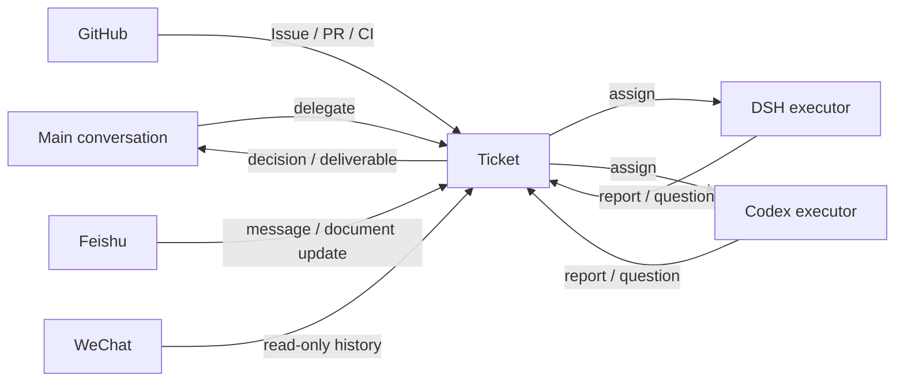

# EnyAgentDesk

> EnyAgentDesk. Chinese name: 任一 (Renyi); full name: 任一智能体工作台.

> This repository is a published snapshot. Development happens on `main`/`develop` in the private upstream; `main` here receives root commits exported and mirrored from it, tagged with `Upstream-Commit`. Issues are welcome. Code pull requests are not merged directly; equivalent changes are implemented upstream and arrive with the next export.

**Hand off the work. Keep your attention.**

EnyAgentDesk is a personal AI workbench that runs on your own computer. You delegate in one conversation. It turns the request into a Ticket with an authorization, an owner, and a deliverable, then hands it to a resident agent session. It comes back to you only when it needs a decision or a review.

It is a [DeepSeek Harness](https://www.deepseek.com/en/harness/) bundle built on the open-source [dsh-superagent-prototype](https://github.com/deepseek-ai/dsh-superagent-prototype). **It is not an official DeepSeek product.**

## Why it exists

The problem with chat-shaped agents is not intelligence. It is continuity.

- Separate sessions still need someone to coordinate context and results.
- Work across stages needs a durable goal, progress and waiting conditions.
- Three open windows make you the scheduler.
- The agent reports every step, so you become its progress bar.
- It says it is done, but you cannot see what it changed or checked.

EnyAgentDesk changes three things.

**The unit is a Ticket, not a conversation.** A Ticket holds its goal, authorization, executor, progress, waiting condition, and deliverables. The conversation can end. The Ticket does not.

**Execution is a resident session, not a single answer.** Each Ticket has its own executor session and working directory. Closing the browser does not stop it, and a restart resumes it.

**Notifications are exceptions, not progress updates.** It asks one structured question when a decision is needed, and stays quiet otherwise.

## One day with it

1. **Say it.** In the main conversation, state the goal, the stopping point, and anything that must not happen. You can delegate several unrelated pieces of work at once.
2. **Admit it.** The workbench decides whether this is an explicit request, who may originate it, and how wide the mandate is. If it is ambiguous, it asks instead of guessing.
3. **Run it.** The Ticket goes to an executor in its own directory and persistent session. The executor can be DSH or a local Codex App Server.
4. **Report it.** A decision comes back with its context. A result comes back with its conclusion and deliverable links in the original conversation.
5. **Close it.** Review, revise, continue, pause, or stop. Stopping withdraws the mandate, so a later message on the same thread does not silently revive it.

## What it does today

- **One main conversation** for discussion, delegation, and questions about the whole workload. Ordinary chat does not become a Ticket.
- **One personal workspace** showing current focus, decisions that need you, work in progress, and results from the last 24 hours.
- **Several sources.** GitHub Issues, pull requests, comments, and CI; Feishu chats, direct messages, and document updates; read-only WeChat history from this machine; and the workbench's own sessions.
- **Two executors.** Native DSH sessions and a local Codex App Server. With Codex configured, new Tickets can be routed by kind (documentation, research, implementation, auxiliary) or pinned to a model.
- **Ticket controls.** Priority, due time, next follow-up, pause, stop, continue, retry, and executor handoff.
- **Verifiable deliverables.** Pull requests, issues, documents, images, and text files. Paths and hashes are checked before the panel previews them.
- **Authorization and observe mode.** Each source has its own allowed list. Proactive admission can start in `observe`, which records what it would do without doing it.
- **A management panel.** Sources, triggers, evaluations, executions, settings, and save history, with health and failure reasons.

## Configure the native workbench

The example profile enables the native workbench plugin. Once the service is ready:

```sh
python scripts/configure-workbench.py --port 3082 --owner local-owner
```

Use a stable local owner label, not a token. The helper preserves other settings and domains, refuses a different owner, and configures the Source allowlist. DSH still authenticates the browser. Enable other Sources separately. WeChat requires a separately authorized local read-only tool; no chat records or decryption material are distributed. Mail, calendar, tasks and approvals are not built-in continuous Sources.

## Quick start

### Let an agent install it

This is the recommended path. Open Codex, DSH, or another coding agent that can read and write your machine, and give it the repository plus this instruction:

```text
Install this project for me: https://github.com/ShengrenHOU/EnyAgentDesk

Read INSTALL.md first and follow it. The install uses one enyagentdesk.install.json
and one command. When you need me to create an account, sign a CLI in, provide a
model key or a Feishu chat, stop and give me the exact commands. After it works,
run self-check, report every failed check with the next step, then ask what I want
to hand over first.
```

`INSTALL.md` is written for the agent. It probes the environment, asks only the questions it needs, prepares one config, previews the plan, then installs both Sources and runs the self-check. A single-Source profile is outside this flow.

### Manual install

Requirements: Node.js 22.19+ or 24+, pnpm, git 2.32+, Python 3.8+, and a configured model provider for DeepSeek Harness. The GitHub source needs `gh` 2.48+ and an agent account with write access. The Feishu source needs `lark-cli`, a published Feishu app and a bot-only configuration. tmux is only needed by the POSIX service script.

```sh
git clone https://github.com/ShengrenHOU/EnyAgentDesk enyagentdesk && cd enyagentdesk
cp examples/install.minimal.json enyagentdesk.install.json
# Fill enyagentdesk.install.json; INSTALL.md explains every field.

node scripts/install.mjs --config enyagentdesk.install.json --dry-run
node scripts/install.mjs --config enyagentdesk.install.json
node scripts/self-check.mjs --config enyagentdesk.install.json
```

The installer creates the profile, builds and links the bundle, writes the machine configuration, starts the process, and saves GitHub, Feishu, the allowed lists and the executor settings through the local management API. It needs no internal package; everything comes from this repository and the public DSH, `gh` and `lark-cli`.

The original manual profile setup and service commands are in [docs/006-deployment.md](docs/006-deployment.md). Windows installation, the Codex path, the owner launcher, and recovery are covered in [Codex on Windows](docs/009-codex-windows.md).

**Security note.** It acts with your accounts and listens on localhost by default. Do not expose the management port to the public internet. Start with a short allowed list and `observe` mode, inspect what it would do, and widen access only after that. Workers run as your OS user, not in a sandbox; use a separate OS account if you need isolation. The full limits are in [INSTALL.md](INSTALL.md#6-limits).

## How it works



- **Source.** An entry point for events: GitHub, Feishu, WeChat, the workbench. Each source keeps its own read position, allowed list, and reply channel.
- **Ticket.** The full life of one piece of work. It records who asked, on what authority, within what scope, and every assignment, question, and deliverable.
- **Executor.** The agent session that does the work. One Ticket runs on one executor at a time, but can be handed to another.
- **Decision.** Accept, reopen, stop, or ignore. Only an explicit request or a written rule creates a Ticket.
- **Deliverable.** A pull request, a link, a file, or a conclusion. Reported links are verified before they are shown; a failed check is never presented as success.

The full model is in [001 Domain model](docs/001-domain.md), and the implementation map is in [007 Architecture](docs/007-architecture.md).

## Documentation

- [000 Philosophy](docs/000-philosophy.md): why the project is shaped this way
- [001 Domain model](docs/001-domain.md): sources, tickets, executors, decisions
- [002 Authorization](docs/002-authorization.md): who may originate work, and when a mandate ends
- [003 Execution](docs/003-execution.md): executors, sessions, directories, recovery
- [004 Prompts](docs/004-prompts.md): how the agent instructions are assembled
- [005 Panel](docs/005-panel.md): what each page answers
- [006 Deployment](docs/006-deployment.md): install, configuration, upgrades, troubleshooting
- [007 Architecture](docs/007-architecture.md): code structure and module index
- [008 Cookbook](docs/008-cookbook.md): adding a source
- [009 Codex on Windows](docs/009-codex-windows.md): local Codex execution on Windows

A Chinese README is in [README.zh-CN.md](README.zh-CN.md). The deep documentation is currently English-first.

## Relationship to upstream

This project builds on the [dsh-superagent-prototype](https://github.com/deepseek-ai/dsh-superagent-prototype) released by the DeepSeek Harness team. Upstream provides the event, evaluation, ticket, mandate, subscription, executor, and panel model. This repository adds the personal workbench layer: the native workspace, the Codex executor, Windows launch and recovery, Feishu and WeChat activity sources, follow-up and management tools, and broader executor routing.

Upstream code is MIT licensed and copyright DeepSeek Harness Team. This repository is Apache-2.0 licensed, and the upstream MIT license and attribution are retained. The two are not guaranteed to stay in sync. Upgrades record the upstream commit actually adopted and the checks that were run.

## Status and limits

Treat this as an early project.

- Version 0.5.x. Interfaces, configuration, and UI may change.
- Development and daily use are Windows-first. Linux/WSL has test coverage but less day-to-day validation.
- It is a single-owner local tool, not a multi-tenant service. No account system, admin console, or cloud scheduler.
- The computer must stay awake and connected. Sleep, shutdown, and network loss stop running work; see the deployment document for recovery.
- It depends on alpha versions of DSH and Codex. Upstream changes can break compatibility.
- It acts with your GitHub and Feishu identities. The short allowed list, least privilege, and `observe` mode are part of the security boundary. Do not skip them.
- English documentation is complete. Chinese documentation currently covers installation and daily use.
- There is no production-grade observability, quota, or audit export. Keep your own receipts for important operations.

## Contributing

- Search existing issues before opening a new one.
- Read [CONTRIBUTING.md](CONTRIBUTING.md) before a pull request, and run `pnpm check`.
- Report security problems privately as described in [SECURITY.md](SECURITY.md), not in a public issue.
- Discuss large changes in an issue before implementing them.

## License

This repository is [Apache-2.0](LICENSE) licensed. Upstream code remains [MIT](LICENSES/MIT.txt), copyright the DeepSeek Harness Team; see [NOTICE](NOTICE) for the full attribution.
