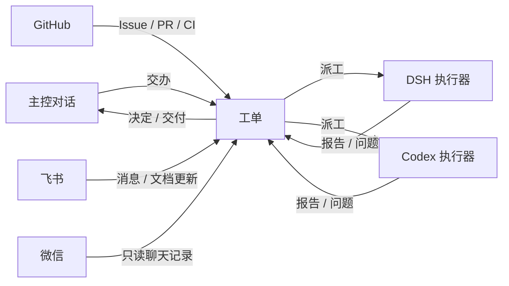
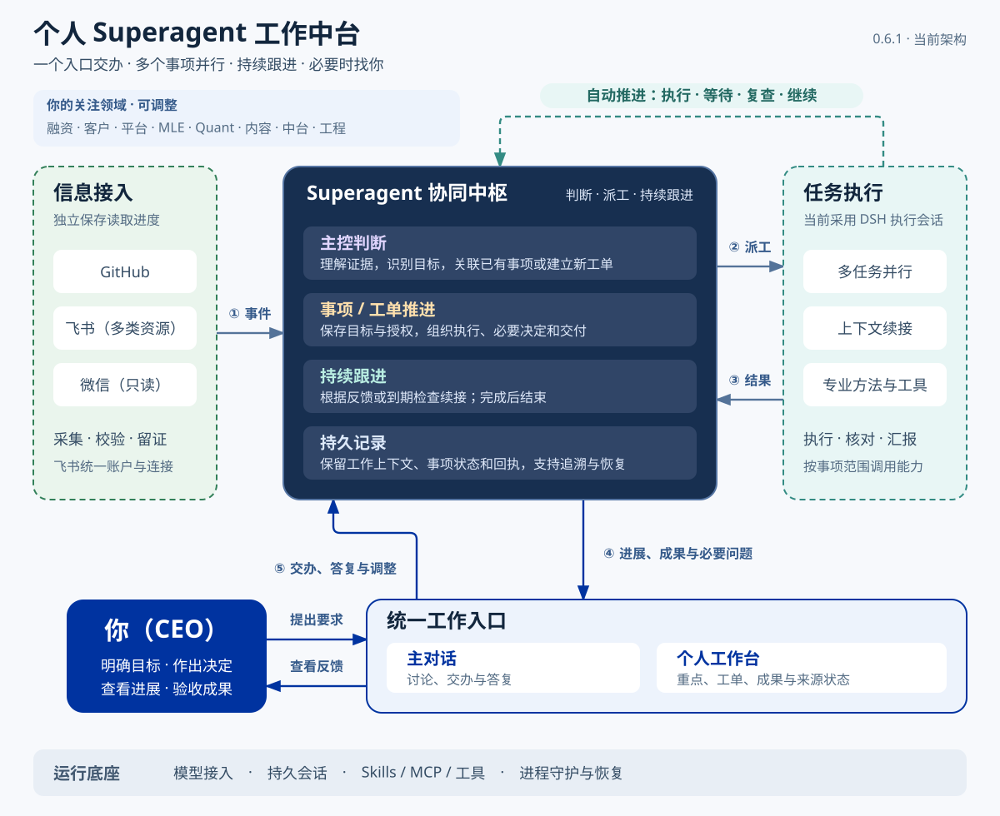

# EnyAgentDesk · 任一

> 正式名：EnyAgentDesk。中文名：任一，完整写作「任一智能体工作台」。
>
> English: [README.en.md](README.en.md)

> 本仓库是公开发布快照。开发在私有上游的 `main`/`develop` 分支进行；这里的 `main` 只接收由导出脚本生成、经候选检查并镜像的连续公开快照，提交信息带 `Upstream-Commit`。欢迎提 Issue；代码 PR 不会被合并，等价改动会在上游实现后随下次发布进入这里。

**把工作交出去，把注意力拿回来。**

EnyAgentDesk（中文名「任一」）是一个跑在你自己电脑上的个人 AI 工作台。你在一段对话里把事交出去，它把这句话变成一张有授权、有负责人、有交付物的工单，交给常驻的 Agent 去做。只有需要你拍板或验收时，它才回来找你。

它是 [DeepSeek Harness](https://www.deepseek.com/en/harness/) 的一个 bundle，基于 DeepSeek 开源的 [dsh-superagent-prototype](https://github.com/deepseek-ai/dsh-superagent-prototype) 改编。**不是 DeepSeek 官方产品。**

## 为什么需要它

聊天式 Agent 的问题不是不聪明，是没有连续性。

- 多个会话之间的上下文和结果仍需要自己衔接。
- 一件事跨多个阶段推进，需要持续保留目标、进展和等待条件。
- 同时开三个窗口，最后你自己成了调度器。
- 它每做一步都来问你，你被训练成它的进度条。
- 它说做完了，但你看不到它改了什么、验证了什么。

它换了三个东西。

第一，**单位从对话变成工单**。一张工单记住目标、授权、执行器、进展、等待条件和交付物。对话可以结束，工单不会。

第二，**执行从一次回答变成常驻会话**。每个工单有自己的执行会话和工作目录，关掉浏览器它继续跑，重启后能接上。

第三，**通知从每步汇报变成只在必要时找你**。需要决定时提一个结构化的问题，不需要你时保持安静。

## 一次完整的日常

1. **说**。在主控对话里说清楚要做什么、做到什么程度、哪些事不要做。可以一次交办多件互不相关的事。
2. **接**。工作台判断这是不是一个明确的请求，谁有权发起，授权范围多大。不明确时会问，不会猜。
3. **做**。工单派给执行器，在独立目录和持久会话里推进。执行器可以是 DSH，也可以是本机的 Codex。
4. **回**。需要你决定时，问题会带着上下文回来；有结果时，结论和交付物链接会回到原对话。
5. **收**。验收、返工、继续、暂停或停止。停止会收回授权，之后同一个话题里的新消息不会自动恢复它。

## 现在能做什么

- **一个主控对话**。日常讨论、交办、询问全局进展都在这里；普通聊天不会自动变成工单。
- **一个个人工作台**。当前重点、等待你决定的事、进行中的工作、最近 24 小时的成果，都在一页里。
- **多个来源**。GitHub 的 Issue、PR、评论和 CI；飞书的群聊、私聊和文档更新；微信的聊天记录（只读，依赖本机已授权的记录）；以及工作台自己的会话。
- **两个执行器**。DSH 原生会话和本机 Codex App Server。配置 Codex 后，新工单还可以按文档、研究、实现、辅助四类路由，或者显式指定模型。
- **工单管理**。优先级、截止时间、下次跟进、暂停、停止、继续、重试、执行器交接。
- **可核对的交付**。PR、Issue、文档链接、图片和文本文件；先校验路径和哈希，再在面板里预览。
- **权限与观察模式**。每个来源有自己的允许名单；主动接单可以先跑 `observe`，只记录会做什么，不真的做。
- **管理面板**。来源、触发、评估、执行、设置和保存历史；健康状态和失败原因都在这里。

## 原生工作台的首次配置

示例 profile 已启用原生工作台插件。服务就绪后运行：

```sh
python scripts/configure-workbench.py --port 3082 --owner local-owner
```

`local-owner` 是稳定的本地 owner 标识，不是令牌。脚本保留其他配置与领域，拒绝覆盖不同 owner，并配置该来源的允许名单。DSH 仍负责浏览器认证。若使用其他端口，传入对应端口。其他来源单独启用；微信读取依赖你已授权安装的本机只读工具，仓库不包含聊天记录或解密材料。邮箱、日历、任务和审批不属于当前内置持续来源。

## 快速开始

### 让 Agent 帮你装

这是推荐方式。打开你的 Codex、DSH 或其他能读写本机的编码 Agent，把下面这段话和仓库地址给它：

```text
帮我安装这个项目：https://github.com/ShengrenHOU/EnyAgentDesk

先读 INSTALL.md，按里面的步骤装。安装用一份 enyagentdesk.install.json 和一条命令。
中间需要我创建账号、登录 CLI、提供模型密钥或飞书群的，停下来告诉我具体命令，我自己执行。
装好以后跑一遍 self-check，把失败项和下一步告诉我，再问我平时想把哪些事交给它。
```

`INSTALL.md` 是写给 Agent 看的。它只问必要的问题，准备好一份配置，先用 `--dry-run` 给你看计划，再执行安装和自检。GitHub 和飞书两个来源都要接上；单个来源不在这个安装流程里。

### 手动安装

要求：Node.js 22.19+ 或 24+、pnpm、git 2.32+、Python 3.8+，以及一个配置好模型服务的 DeepSeek Harness。GitHub 来源需要 `gh` 2.48+ 和一个有仓库写权限的 Agent 账号；飞书来源需要 `lark-cli`、一个已发布的飞书应用和 bot-only 配置。

```sh
git clone https://github.com/ShengrenHOU/EnyAgentDesk enyagentdesk && cd enyagentdesk
cp examples/install.minimal.json enyagentdesk.install.json
# 填写 enyagentdesk.install.json；完整字段见 INSTALL.md

node scripts/install.mjs --config enyagentdesk.install.json --dry-run
node scripts/install.mjs --config enyagentdesk.install.json
node scripts/self-check.mjs --config enyagentdesk.install.json
```

安装器负责建 profile、装 bundle、写机器配置、启动服务，并通过本机管理 API 保存 GitHub、飞书、允许名单和执行器设置。安装和运行都不需要内部包；只从本仓库和公开的 DSH、`gh`、`lark-cli` 获取。

已有 profile 的原始安装、手工配置和启动方式见 [docs/006-deployment.md](docs/006-deployment.md)。Windows 的 Codex 路径、前台启动器和恢复步骤见 [Codex on Windows](docs/009-codex-windows.md)。

**安全提醒**：它用你的账号在工作，默认只监听本机。不要把管理端口暴露到公网。第一次先把允许名单设小，主动接单设为 `observe`，看过它想做什么之后再放开。Worker 以你的操作系统用户运行，不是沙箱；需要隔离时用单独的系统账号。完整限制见 [INSTALL.md](INSTALL.md#6-limits)。

## 它是怎么工作的



几个关键词。

- **来源 Source**。事件的入口，比如 GitHub、飞书、微信、工作台。每个来源有自己的读取位置、允许名单和回复渠道。
- **工单 Ticket**。一件事的完整生命周期。它记录是谁、以什么依据、在什么范围内让你做这件事，也记录每一次派工、每一个问题、每一份交付。
- **执行器 Executor**。真正干活的 Agent 会话。一个工单同一时间只在一个执行器上跑，但可以在工单之间切换。
- **决定 Decision**。接单、续做、停止、忽略。只有明确的请求或写下来的规则能产生工单。
- **交付 Deliverable**。PR、链接、文件或一段结论。报告里的链接会先验证再展示，失败的验证不会被当成成功。

更完整的定义见 [001 Domain model](docs/001-domain.md)，实现见 [007 Architecture](docs/007-architecture.md)。

## 文档

- [000 Philosophy](docs/000-philosophy.md)：这个项目为什么这样设计
- [001 Domain model](docs/001-domain.md)：来源、工单、执行器、决定
- [002 Authorization](docs/002-authorization.md)：谁可以发起工作，授权如何失效
- [003 Execution](docs/003-execution.md)：执行器、会话、目录与恢复
- [004 Prompts](docs/004-prompts.md)：给 Agent 的提示词如何组织
- [005 Panel](docs/005-panel.md)：面板上每个页面回答什么问题
- [006 Deployment](docs/006-deployment.md)：安装、配置、升级和排查
- [007 Architecture](docs/007-architecture.md)：代码结构和模块索引
- [008 Cookbook](docs/008-cookbook.md)：新增一个来源
- [009 Codex on Windows](docs/009-codex-windows.md)：Windows 本机执行

中文的安装与日常使用说明在 [docs/zh/guide.md](docs/zh/guide.md)。英文文档是当前的主文档集，中文文档会继续补齐。

## 和上游的关系



持续跟进、事件唤醒和减少人工打断的设计也参考了 [Agent Autoloop](https://github.com/KKKKhazix/agent-autoloop)。这些能力通过 DSH 与 Superagent 的现有会话、工单和扩展接口实现。

这个项目建立在 DeepSeek Harness 团队开源的 [dsh-superagent-prototype](https://github.com/deepseek-ai/dsh-superagent-prototype) 之上。上游提供了事件、评估、工单、授权、订阅、执行器和面板的基本模型。本仓库补的是个人工作台这一层，包括原生工作台、Codex 执行器、Windows 启动与恢复、飞书和微信的活动来源、跟进与管理工具，以及更完整的多执行器路由。

上游代码使用 MIT 许可证，版权归 DeepSeek Harness Team。本仓库以 Apache-2.0 许可证发布，并保留上游的 MIT 许可证和来源说明。两边的差异不保证和上游同步，升级时以实际采用的上游提交和验证记录为准。

## 现状与限制

这是一个还在早期的东西，请按早期项目对待。

- 版本是 0.5.x，接口、配置和界面都可能变。
- 主要开发和验证在 Windows 上，Linux/WSL 有测试覆盖，但没有同等程度的日常使用验证。
- 它是给一个人用的本机工具，不是多租户服务。没有账号体系、权限后台和云端调度。
- 需要电脑保持开机和联网。关机、睡眠和断网都会让正在跑的工作停下来，恢复行为见部署文档。
- 依赖 DSH 和 Codex 的 alpha 版本，上游变动可能带来兼容问题。
- 它会用你的 GitHub、飞书身份工作。默认的最小权限、允许名单和 `observe` 模式是安全边界的一部分，不要跳过。
- 英文文档是完整的，中文文档目前覆盖安装和日常使用，架构细节仍以英文为准。
- 没有生产级的可观测性、配额和审计导出。重要操作请自己保留回执。

## 参与

- 提 Issue 前先搜一下有没有同样的问题。
- 提 PR 前先读 [CONTRIBUTING.md](CONTRIBUTING.md)，并跑 `pnpm check`。
- 安全问题不要公开提 Issue，按 [SECURITY.md](SECURITY.md) 的说明私下联系。
- 这个项目接受「先讨论，再动手」的方式。大的方向先开 Issue，避免做完才发现方向不对。

## License

本仓库以 [Apache-2.0](LICENSE) 发布。上游代码保留 [MIT](LICENSES/MIT.txt) 许可证，版权归 DeepSeek Harness Team；完整来源说明见 [NOTICE](NOTICE)。
