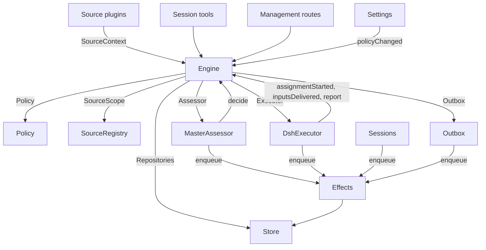

# 007 Architecture

This is the developer guide to the implementation. It maps the concepts in [001 Domain model](001-domain.md) through [006 Deployment](006-deployment.md) to classes, interfaces and files. Start with the runtime and Engine, then use the module and test tables as a code index.

## Core classes and glue

Core classes own domain concepts and external boundaries behind small interfaces. Glue translates tool arguments, HTTP requests, Source payloads and DeepSeek Harness events into calls to those classes, then turns results into cards, views and messages.

`Runtime` (`src/app/runtime.ts`) constructs the application, supplies dependencies, and owns startup and shutdown. `Engine` constructs its own internal parts. The Executor and Assessor call back into the Engine, so Runtime gives them getters rather than requiring construction in a circular order.

### Runtime

`Runtime` is the composition root; it contains no domain rules. Its constructor locks the state directory, opens the Store and builds each component. If construction fails, it closes the Store and releases the lock.

Startup registers management routes and runs Setup. After setup resolves, it installs Session and Executor hooks, ensures the main Session exists, starts Policy syncs, resumes interrupted Assignments, and starts passes and effects. `ready` marks completion of startup.

Shutdown cancels turns, waits for passes, effects and agents, restores the process environment, closes the Store and releases the lock. Source plugins inject Runtime as the `orchestrator` service through the narrow `SourceHost` interface.

Source plugins register their background loops through `SourceHost.runSource`. Runtime cancellation aborts those loops and waits for their pending state access to finish before closing the Store. Disabling an individual plugin cancels only its own loop.

| Part | Module | Does |
| --- | --- | --- |
| Setup | `src/app/setup.ts` | Resolves the repository and the accounts by probing their CLIs the way worker shells run them, writes and applies the workers' environment and command shims, and keeps the setup problems; Settings checks a changed account through it, and restarts through it, which runs setup again |
| Passes | `src/app/passes.ts` | One pass at a time, every two seconds and whenever a command asks: the due effects, then `Engine.evaluateDue`; a Source's Trigger reaches the Engine through it |
| Outbox | `src/app/outbox.ts` | The Engine's `Outbox` port, and the only writer of the receipts: `send` keeps a message's receipt and queues its `reply` effect in one transaction, and the effect's handler sends it through `SourceRegistry.send`; a message waits while its Source is off, and is dropped when the conversation is gone or not listened to |
| Notices | `src/app/notices.ts` | Converts domain events and worker activity into main-Session messages. `eventNotice` handles domain notices; `reportRelay` forwards questions immediately, keeps ordinary progress on its Ticket, and relays other reports; `followupRelay` names the Tickets that own a human follow-up. Relays arriving during a turn are delivered together at its next step through the DeepSeek Harness inbox |

### Engine

`Engine` (`src/core/engine.ts`) is the only writer of Triggers, Threads, Decisions, Tickets and Assignments. It receives these ports from `src/core/ports.ts`: `Repositories`, a current-Policy getter, `SourceScope`, `Assessor`, `Executor` and `Outbox`. Optional dependencies are `prepareTicket`, `now` and `emit`.

All Engine methods are synchronous. Each command changes its aggregates in one transaction. `evaluateDue` uses a separate transaction for each Eval or Ticket it changes. Ports enqueue external work inside the transaction; adapters perform it after commit. Invalid requests throw `UserError`.

### Eval admission backpressure

`Engine.evaluateDue` admits at most four undecided Evals, including both undelivered candidates and delivered candidates awaiting a Decision. Each gate-strength lane (`explicit` and `inferred`) may hold at most three, reserving one slot for the other lane even when that slot is idle. The gate, not `human`, source identity or message text, determines the lane. This bounds admission to the existing assessor; the assessment effect's separate delivery concurrency is not a bound on undecided work. Direct synchronous `decide` calls still finish immediately and do not consume an in-flight slot.

Waiting evidence remains in `Thread.pending` without an Eval, candidate effect or running timeout. Within each lane, Threads are considered by persisted `evalQueuedAt` (local enqueue time, not source event time), with Thread key as a deterministic tie-breaker. New evidence on a waiting Thread preserves its age. Expiry and reassessment join the tail, so retries cannot continuously overtake waiting Threads. Legacy Threads without that optional field use `createdAt`, a stable conservative fallback. Pause and SQLite restart preserve these fields. Rejected or worker-owned pending evidence is still cleaned through the existing gate/ownership paths even when admission is full.

This is Thread-level FIFO fairness, not per-IM/source quotas, semantic batching, relevance filtering, or a fresh-ordinary-message fast lane. A large finite ordinary backlog still takes time to drain. An explicit message arriving on a Thread already being evaluated waits for that Eval; reserved capacity does not preempt the per-Thread Eval or its evidence. Existing excess in-flight Evals after an upgrade drain normally; they are not cancelled or fabricated as completed. Already-delivered floods and historical `unavailable` Decisions are not repaired automatically. The timeout still starts at candidate delivery, not model acknowledgement. Trigger identity, subscriptions, authorization and Ticket creation semantics are unchanged. The production IM pipeline and its work-evidence handoff are described below.

The Engine exposes one entry point and delegates to five internal parts. It owns each command's transaction. Commands spanning parts, such as `attach`, `evaluateDue` and `policyChanged`, call the parts in sequence.

Each part extends `EnginePart` (`src/core/part.ts`), which provides options and shared reads. Dependencies between the parts flow in one direction:

| Part | Responsibility | Depends on |
| --- | --- | --- |
| `Intake` | A Source's Trigger: stored once with its disposition, recorded on its Threads and their correlations, fanned out to the subscribed Tickets and, unless it is a person's message that reached one, queued for Eval on its primary Thread | Tickets |
| `Evals` | The Evals of Threads: batching, the gate's strength, actor and basis with the Trigger that gave them (`primary`), the deadline from the candidate's delivery and its shift by a pause, the requeue of an expired Eval, candidates, replays and hand-backs, the requeue on a Policy change, and the Decision each ends with: accept, stop, ignore or unavailable | Tickets |
| `Tickets` | The Ticket lifecycle: creation from an accept with its Mandate, Subscriptions and first Assignment, the Threads it follows and their closes (`followsDone`), attached Threads and Threads followed for context, Inputs and notes, resume and the messages a resume refuses, retry, restart, stop and end, the Subscriptions it drops, and the notice of a Policy change to the Tickets it bears on | Replies |
| `Assignments` | What the Executor and its workers report: an Assignment started, Inputs reached it or failed to, a restart interrupted it, and a worker's Report with its question for a person | Tickets, Replies |
| `Replies` | Channel writes through the `Outbox`: the acknowledgement, the answer, the result and the attention message, each by the rule that allows it | Nothing |

Commands use imperative names such as `stopTicket`; facts reported by adapters use past-tense names such as `assignmentStarted`. The query `candidate` uses a noun.

Callers receive only their role's `Pick` of the Engine: `EngineForSources`, `EngineForMainSession`, `EngineForPeople`, `EngineForSettings` or `EngineForExecutor`.

| Role | Method | Effect |
| --- | --- | --- |
| Sources | `receive(trigger)` | Stores a Trigger once and answers `stored`, `duplicate`, or `filtered` when no Source receives it; fans it out to the Tickets subscribed to its Threads, where a person's message resumes an ended Ticket at once unless processing is paused, and queues it for Eval on its primary Thread, unless it is a person's message that reached a Ticket, which stays that Ticket's |
| Sources | `bindThread(ticketId, thread, own)` | Makes an open Ticket follow one of the Source's Threads, such as a pull request's, `own` when the Ticket opened it; a closed Thread bound again is open again. The Threads' closes, not a `ready` Report, end the Ticket |
| Sources | `threadClosed(thread, outcome, at)` | A Thread closed: each open Ticket that follows it records the close, and ends once it is done with the Threads it follows (`followsDone`): no Thread it opened is open, or, when it opened none, every Thread it follows closed. It ends `merged` or `closed` as the latest of those closes did, unless work resumed after the close has not reported `ready`, or its Executor took up, by acknowledging or answering it, a person's follow-up it decides after its latest Report other than `progress`, or the end of its last turn; a `dropped` Report then ends it as the close did |
| Main Session | `candidate(triggerId)` | The Eval that holds a Trigger, as its assessor sees it |
| Main Session | `candidateDelivered(evalId)` | The main Session consumed the Eval's candidate from its inbox: its deadline counts from now |
| Main Session | `decide(triggerId, outcome)` | Records an Eval Decision, or a direct Decision for an explicit request. Accept creates the Ticket, Mandate, Assignment, Subscriptions and acknowledgement atomically. An inferred candidate ignored from its card records `ignoredFromCard` before the supplied reason. While `followupOwners` still owns a human follow-up, only stop is allowed |
| Main Session | `attach(ticketId, triggerId, note?)` | Routes a Trigger to a Ticket it points at, whose Executor then decides it as a follow-up, and ends the Eval that holds it, whose other Triggers wait for a fresh Eval; an ended Ticket resumes under its Mandate at once unless processing is paused. A follow-up an Executor still decides is refused, as is one routed back to the Ticket that handed it back |
| Main Session | `requestStatus(ticketId)` | Asks a waiting Executor Session for its status, and answers whether it asked |
| Main Session | `note(ticketId, text)` | Gives a Ticket's Executor a fact from other work as a text Input, which grants nothing |
| Main Session, Executor | `reply(request)` | Queues a message for the Channel its purpose names: `acknowledgement`, `answer`, `result` or `attention` |
| Follow-ups | `scheduleFollowup(ticketId, followup)` | Records a scheduled follow-up on an open Ticket; the service keeps its receipt and checks the Mandate |
| Follow-ups | `finishFollowup(ticketId, followupId, at)` | Removes a follow-up that fired or was cancelled, and answers whether the Ticket had it |
| People | `stopTicket(ticketId, reason?)` | A person's stop, which withdraws the Mandate |
| People | `retryTicket(ticketId)` | Ends the stalled Assignment of a Ticket that waits for a person after a `failed` or `blocked` Report, or whose Input delivery failed (`canRetry`), and starts a new one |
| People | `updateTicketManagement(ticketId, patch)` | Applies a priority, a known deadline or a pause of future work to an open Ticket, and records the change as an event |
| People | `reevaluate(triggerId)` | Queues a stored Trigger for a fresh Eval |
| People | `unsubscribe(thread)` | Drops every Subscription on a Thread, and the Tickets that followed it follow it no more; each keeps deciding the follow-ups it received there |
| People | `dismiss(decisionId)` | Dismisses the problem an `unavailable` Decision shows, which the Decision records |
| Executor | `assignmentStarted(ticketId, assignmentId)` | An Assignment runs; its waiting Inputs go out |
| Executor | `inputsDelivered(ticketId, assignmentId, inputIds)` | Inputs reached the Assignment's Executor Session, where each waits for a step to take it |
| Executor | `inputsRead(ticketId, inputIds)` | The Executor Session took the messages that carry these Inputs into its history (a `user/message` Session event), from which its model has them; a step that claimed them and was cancelled or failed before does not count. Each counts as read once a Report or the end of a turn follows, also after a restart, and its Ticket's end does not let go of it; an Input delivered before reads were recorded counts as read once a Report or the end of a turn followed its delivery |
| Executor | `turnEnded(ticketId, assignmentId)` | A turn of the Executor Session ended, also after a Report, once nothing runs for it in the background or as it hands off to a person. What a step took before, it read (`inputsRead`) |
| Executor | `deliveryFailed(ticketId, assignmentId, error)` | Delivering Inputs failed; the Ticket shows it until a delivery succeeds, a new Assignment starts or the Ticket ends |
| Executor | `report(ticketId, report)` | Records a Report and its question for a person; `dropped` ends the Ticket, and `ready` completes one that follows no Thread, and ends one done with the Threads it follows as they ended |
| Executor | `markUnrelated(ticketId, thread, reason)` | Drops only that Ticket's Subscription to an attached Thread it found unrelated, and hands back, with the reason, the follow-ups there that the Ticket decides |
| Executor | `followForContext(ticketId, thread)` | Subscribes an open Ticket to a related Thread for context: its messages reach the Ticket but lend it no follow-up strength and do not resume it |
| Executor | `handback(ticketId, triggerId, reason)` | Records that the Ticket hands back a Trigger that reached it, with the reason its candidate carries, and queues it for a fresh Eval once no other Ticket decides it, if this Ticket did; it answers whether it queued it. A Ticket hands back each Trigger once and keeps its Subscription |
| Executor | `assignmentInterrupted(ticketId, assignmentId)` | An Assignment was running when the host stopped: one interrupted mid-work, or one that received an Input after its latest Report, starts again with a recovery note and the Inputs delivered to it that its Executor Session did not take, as a retry does; one that had reported since keeps its Session. The DshExecutor reports each at start (`resume`), oldest Ticket first, and queues again a launch that waits |
| Executor | `assignExecutor(ticketId, executor, handoff?)` | Records the Executor that owns a Ticket's work and the handoff that moved it there: its startup binding, a transfer between executors, or a continuation of stopped work |
| Passes | `evaluateDue()` | Unless processing is paused: starts the Evals of the Threads whose queued Triggers wait, one per Thread with the Triggers queued meanwhile as one batch; queues the Triggers of an Eval past its deadline again, twice in a row, and records it `unavailable` the third time; and resumes the ended Tickets a person's message reached during a pause, if their Mandates still hold. An Eval whose candidate is still unread in the main Session inbox does not expire. While processing is paused, no Eval expires, and once it resumes each deadline moves later by the pause's length |
| Settings | `policyChanged(from, to, effects)` | Tells each live Ticket the change bears on how (`policyEffects` in `src/policy.ts`: a rule it was accepted under changed or no longer applies, its requester may no longer start work, or proactive work is no longer accepted), and restarts the Evals in progress under the new version |

The Engine keeps batching, authorization, fan-out, resume and attention lifecycle rules private. Several shared predicates make these rules consistent:

- `waitsForPerson` (`src/core/model.ts`): the latest Assignment reported `blocked` or `failed`, and no human message has arrived since. Automatic Inputs and failed launches remain held while this is true.
- `followupOwners`: the Tickets still responsible for a human follow-up received on their own Threads. A Ticket can be live or ended without a human stop and waiting to resume. Handing back the message ends that ownership.
- `settled`: a Decision resolved the request; stop, unavailable, routed and refused-stop Decisions do not count.
- `ticketStage` (`src/core/stage.ts`): implements the stage table in [003 Execution](003-execution.md).

When a Ticket ends, unread follow-ups return to Eval unless another Ticket still owns them or another disposition settled them. Acknowledged, answered and handed-back messages are excluded. For older records without acknowledgement dispositions, the outbox receipt supplies that fact. A final Report also covers messages waiting when the Assignment began, including the message that resumed it. The message that stopped a Ticket is not automatically re-evaluated.

After a change, the Engine emits an event from `DomainEvents` in `src/core/ports.ts`:

`trigger.received`, `eval.started`, `decision.recorded`, `ticket.created`, `ticket.resumed`, `ticket.ended`, `assignment.started`, `assignment.ended`, `thread.subscribed`, `thread.unsubscribed`, `trigger.requeued`, or `policy.changed`.

Runtime turns `ticket.ended`, `trigger.requeued` and `thread.unsubscribed` into notices. A human `trigger.received` delivered to Tickets becomes a follow-up relay. `pullEndNotices` sends one chat notice, using a stable id, when a Ticket ends merged or closed. Other events currently have no consumer.

### Model

`src/core/model.ts` holds the domain types, and `src/core/stage.ts` the Ticket stages. A Decision records why as `reason`, a list of `Reason`s (`src/core/reasons.ts`): each a `code` with its `values` and, for one Trigger of a batch, its `triggerId`.

The core's codes, such as `timeout`, `policyChanged`, `routed` and `startedTicket`, are `REASONS`, with the English that agents read through `reasonText`; a gate or a Source scope gives its own, such as `not_a_member`; and `said` carries words an assessor or a person wrote. The panel words each code by `reason.<code>`, and a Trigger a Source filtered records the Source's code the same way.

A Ticket keeps each fact once. It is open while it has no `ended`, which records when, by whom, why and with what outcome it ended; what it last said is its latest Assignment Report (`latestReport`); and its Executor Session is named after it (`workerSessionId` in `src/executor/dsh.ts`).

Its fields are typed: `origin`, the admissible Trigger that gave its Eval's batch its strength and the batch itself (`triggerId`, `triggerIds`); `execution`, what the Executor chose (`name`, `directory` and `assignment`); `delivery`, the last failed Input delivery (`error`, `at`), until a delivery succeeds, a new Assignment starts or the Ticket ends; and `follows`, the Threads a Source made it follow, each `{thread, own, closed?}`: `own` when the Ticket opened it, and `closed` with `at` and `outcome` once it closed. Tickets alone writes `follows`; the GitHub Source reads its pull requests with `pullsOf` and `pullOf` (`src/sources/github-pull.ts`).

An Input that carries a Trigger records whether a person wrote it, which `waitsForPerson` reads. A Thread also lists in `context` the subscribed Tickets that follow it only for context, and counts in `expired` the Evals of its queued Triggers that expired in a row; an Evaluation records its `primary` Trigger and when its candidate was `delivered`.

A Trigger's disposition records the Tickets it reached, by fan-out or attachment, a person's requeue, each Ticket that handed it back, with the reason, and each Ticket whose Executor acknowledged or answered it.

A Mandate's `basis` (`MandateBasis`) records how the gate admitted its Trigger. Revalidation reads the receiving `source`, `scope` and `row`, the listed `sender`, matched `rules`, and `via`:

| `via` | Admission basis |
| --- | --- |
| `addressed` | An allowed sender addressed the agent |
| `followup` | A message arrived on a Thread with Tickets |
| `admission` | An admission-table cell; `observation` marks an inferred candidate |
| `bot` | A listed bot produced an inferred candidate |

Trigger and Thread `meta` belong to the Source. The core does not interpret them.

### Policy

`src/policy.ts` defines settings schemas, authorization and assessment rules. `settingsPolicy(settings, scope)` returns a fresh, stateless `Policy` on each use:

- `version`, `paused` and `evalTimeoutMs` describe its current state.
- `gate(trigger, thread, tickets)` returns admission strength and basis.
- `revalidate(mandate)` checks whether an existing Mandate still holds.
- `admitsInferred(rules)` permits proactive acceptance only in auto mode with enabled matching rules.

`assessmentOutcome(assessment, settings, strength)` converts the model's assessment to an Engine outcome. It requires a judgement for every enabled rule, settled direction, a matching rule and evidence of intent. Outside auto mode, an inferred accept becomes a “would accept” record.

`policyEffects(tickets, old, now, scope)` identifies which open Tickets a change affects and how. `Engine.policyChanged` notifies only those Tickets. `policyVersion` hashes rules, accept mode and the Sources' Policy parts, including bot lists.

### Store

`Store` (`src/app/store.ts`) owns one SQLite database. Runtime acquires the directory lock before opening it, preventing a second process from migrating or writing the same state.

Its interfaces are grouped by purpose:

- **Domain repositories:** `atomic`, plus `triggers`, `threads`, `tickets` and `decisions`, each with `get`, `save` and list queries. Indexed working sets are `threads.active()`, `tickets.open()`, `tickets.active()` and `read.subscribedThreads`.
- **Read queries:** `read` serves views, tools and Source polls through methods such as `threadTriggers`, `triggerStats`, `search` and `droppedReplies`. These methods never write.
- **Source metadata:** `threads.describe` and `threads.patchMeta` update Source-owned Thread metadata.
- **Settings:** `settings`, `saveSettings`, `blockRevision` and `settingsHistory`. Settings and prompts use numbered `Versions` (`src/app/versions.ts`).
- **Outbox receipts:** `replyStatus` and `receipts`, written only by Outbox. Receipt operations are `get`, `waiting`, `behind`, `add`, `settle` and `withdraw`. `behind` checks whether an earlier message for the same Ticket and conversation is waiting with fewer than three failures. A withdrawn message settles with `channelGone` or `channelIgnored`. Read queries expose failed and dropped replies through `failingReplies`, `droppedReplies` and `droppedSince`.
- **Typed key-value records:** `get`, `set`, `delete` and `keys`, using entries from `KV`.

`afterCommit` runs an action only after the transaction commits, never after rollback. Runtime reads records in their stored shape; the schema 11 migration converts older supported records at startup.

### Lines

`src/app/lines.ts` owns work lines: a long-lived owner goal that groups Tickets across stages and Sessions. It stores one `line:<id>` KV record per line, with the line's title, status, ordered Ticket ids and the judgements that put each Ticket there, continued it, or closed or reopened the line. The coordinator uses context to decide whether goals are the same; titles never establish identity or automatically merge lines. Creation retries reuse the native DSH call identity (scoped to the main Session), or the already accepted Ticket identity in routing. Existing line ids stay readable without migration. `reassign` owns membership correction: a move updates both line records in one transaction; a detach removes only the link. Corrections keep the actor, reason and source/destination names and ids, refuse stale links and closed destinations, and never write Tickets or change execution/authority. The owner HTTP route and main Session's `detach`/`move` actions call this same command.

The module is a plain application service over the Store's KV records and Ticket reads; it holds no Engine state, grants no authority and routes nothing. `src/app/tools/main.ts` is its only writer: `orchestrator_line` searches lines and unlinked Tickets, opens, attaches, continues, closes and reopens them; `orchestrator_route` accept can create or join a line in the same transaction as the new Ticket. `continue` records the judgement and calls `Engine.attach` in one transaction, so a refused follow-up leaves no evidence claiming it was continued. `summary`, `detail`, `linesView`, `unlinkedTickets` and `search` are the read model used by the `GET lines` and `GET lines/:id` management routes, the Today panel's line view, and the main Session's `lines` and `line/<id>` resources; `unlinkedTickets` reports the open Tickets on no line, whole count and at most ten Items, and `linesView` keeps ten closed lines while `closedTotal` reports the whole number. `searchTitles` supplies the panel's global search (`GET search`) with at most five title matches, so a goal name recalls its line without reading membership evidence; the Line results stay separate from the Ticket, Thread and Trigger results, and same-titled goals keep their own ids. A line closes only when none of its Tickets is open, and a closed line is reopened only by an explicit judgement with evidence, never by a message.

### Effects

`Effects` (`src/app/effects.ts`) is the durable side-effect queue. A command calls `enqueue(kind, key, payload)` inside its transaction; execution begins only after commit.

Each kind/key pair has one row. Enqueuing the same waiting key replaces its payload and makes it due immediately without changing queue order. `handle(kind, run, options)` registers one handler per kind. It processes due rows oldest first, up to the concurrency limit.

Failures retry with exponential backoff. Throwing `Later` defers work without counting a failure, for example when no worker slot is available. `start` begins processing after setup, `drain` stops it during shutdown while preserving pending rows, and `pending`/`idle` expose queue state.

| Kind | Handler | Does | At once | Retry |
| --- | --- | --- | --- | --- |
| `assessment` | MasterAssessor | Queues at most one unread candidate notice in the main Session, holding remaining assessments durably outside its inbox; after consumption starts the Eval deadline. Stale candidate notices are pruned without removing owner messages or worker reports | 4, none while paused | 2 s doubling to 60 s |
| `launch` | DshExecutor | Launches a pending Assignment: prepare command, Executor Session, assignment message | The free worker slots, none while paused | A passing failure of the model provider or the network runs again after 5 s doubling to 300 s, three times; any other failure, and a failed prepare command, fails its Ticket. One held by a pause or by full worker slots tries again after 5 s |
| `delivery` | DshExecutor | Hands a Ticket's waiting Inputs to its running Assignment, in order | 4, none while paused | 2 s doubling to 60 s; one that waits for a worker slot tries again after 2 s |
| `relay` | Sessions | Steers a worker's report or question, or a person's follow-up, into the main Session's turn | 1, in queue order | 2 s doubling to 60 s |
| `notice` | Sessions | Injects a notice into the main Session without waking it | 1, in queue order | 2 s doubling to 60 s |
| `reply` | Outbox | Sends a message for a Channel through its Source, after the earlier messages of its Ticket to its conversation that have not failed three times; withdrawing the message cancels it | 1, none while paused | 5 s doubling to 300 s; one whose Source is off, or behind an earlier message, tries again after 5 s |

Each kind has a health entry under its name. It reports an error once one of its effects failed three times in a row, except `delivery`, whose failures show on their Ticket instead. Relays keep their order, and so do notices; a failed one holds back the later ones of its kind.

### Sources

Sources extend the host through `SourceKind`, defined in `src/sources/kind.ts`. A kind declares its identity, title, description, configuration `schema` and `fields`, derived `facts`, and `health` entries. Optional behavior includes `scope`, a `channel` (`allowed`, `send`, `link`), `threadContext`, `find`, `policy`, `environment` and `refreshLabels`.

`SourceRegistry` (`registry.ts`) owns registered kinds and stored instances, and implements the Engine's `SourceScope`. Registration claims health entries on `HealthBoard`; duplicate claims and reserved `sync:` names are refused. A SourceContext writes only through its registration's claimed entries, so reports after unregistration do nothing.

Registry configuration methods include `kind`, `instances`, `instance`, `validate`, `validatePolicy`, `policyPart`, `channelAllowed`, `declarations`, `environments`, `find` and `scope`. `find` asks each kind that supports search.

Generic code accesses Source behavior through the registry. `send(message, commands)` calls the kind's Channel and returns `sent`, `gone` or `waiting` if the kind is not installed. `link` resolves its Channel link. `threadContext` pairs a kind's reader with its configuration, or returns nothing when the kind has no reader. Invalid stored configuration leaves the instance inactive with `configError` field paths. Source status and the overview show a configuration error; Settings retains the original enabled choice and raw fields for repair. Invalid field types use a JSON repair form, which keeps the captured revision until an explicit reload; saves still pass the same schema/account checks. Pending Outbox replies wait until the configuration is valid again.

Plugins receive `SourceHost`: the registry and `context(kind)`. The kind itself uses a narrower `SourceContext`, built by `sourceContextOf` in `src/app/source-context.ts`.

That context supplies deployment and commands, setup readiness (`ready`, `configured`, `problem`), configuration, `receive`, `atomic`, and typed `state`. It also exposes Thread reads and metadata writes, Ticket reads and binding/closure commands, Trigger reads, `notify` through Outbox, and `report` for declared health entries.

### DshExecutor

`DshExecutor` (`src/executor/dsh.ts`) provides one Session and directory per Ticket. `start` and `deliver` enqueue `launch` and `delivery` effects. `stop` cancels the turn through `Store.afterCommit`, so a rolled-back end does not stop the worker.

`prepare(ticket, outcome)` supplies the Engine's `prepareTicket` hook: short name, directory and `ticketExecution` assignment text. `workerSessionId(ticket.id)` derives the Session id.

`WorkerSlots` reserves capacity before a launch or a delivery that wakes an idle worker. A human message can use one slot beyond `maxWorkers`, and wakes have priority over launches. `activeCount` supplies panel load.

Transient provider and network failures get three retries. Launches use effect backoff; failed turns receive continuation messages after 15, 30 and 60 seconds. `inputMessage` renders each Input from current Ticket state, and `mandateInstructions` adds the matched-rule limits for inferred work.

`install` subscribes to Session events; `dispose` unsubscribes. A turn end normally reports waiting, except after readiness or while human action is required. Errors report failed. At startup, `resume` reports interrupted Assignments through `assignmentInterrupted` and requeues pending launches that do not wait for a person, oldest Ticket first.

### MasterAssessor

`MasterAssessor` (`src/app/assessment.ts`) lets the main Session assess proactive candidates. `request` queues an assessment effect; `release` drops cached state when its Eval ends.

Its `context`, `read` and `decide` methods serve `orchestrator_eval`, `orchestrator_eval_read` and `orchestrator_eval_decide`. They provide bounded Thread context through `SourceRegistry.threadContext`, repository context, and decision submission. A kind without a context reader supplies only the Trigger and batch.

`assessmentOutcome` converts the model's answer for `Engine.decide`. Evals checks inferred acceptance against the current Policy again.

### Read-only IM identity and window gateway

`src/sources/im-identity.ts` fixes the identity rules shared by collection and reading. A conversation has one object identity from its provider and native conversation ID; a native message has one message identity independent of later edits; a message version has one dedup key. The reader account belongs to the observation, not to the object: the same Feishu message seen through the bot channel and the user-identity collector keeps one object/message/version identity while each observation retains its own account, Source configuration and Trigger. `activityTrigger` records these keys in `meta.im` without changing the existing Trigger ID or admission. `src/app/im-evidence-revisions.ts` retains its original provider/account/conversation watermark formula as observation provenance, so persisted revisions keep their meaning.

`SourceKind.imRead` is an optional read-only capability owned by the Source that holds the native reader. The activity kind implements it for Feishu messages and WeChat: a native conversation ID is used as is; a display name resolves only to one exact visible conversation, otherwise candidates are returned and nothing is read. A name lookup requires complete group and private-chat listings; a truncated listing returns candidates instead of resolving. Feishu reads an ascending half-open window with the bound user identity and matches keywords on the full native text before display truncation. WeChat reads its native snapshot window with a native keyword filter, rejects a continuation whose snapshot changed, and reproduces the collector's sorted-field content fingerprint so the same unchanged message keeps one version key through both paths. Neither reader joins the monitor's incremental ACK protocol. `SourceRegistry.imRead` selects the one enabled Source for the provider and rechecks its configuration after the read.

`src/app/im-read.ts` exposes `orchestrator_im_read` to the Main Session and ticket workers. It validates a window of at most seven days, normalizes each message to the canonical keys above, refuses two versions of one message, and wraps the adapter cursor so a continuation cannot change provider, conversation, window or keyword. Display-name resolution, consistency and source gaps remain explicit; an empty window is reported as empty, not complete history. The host bounds one page to 100 messages, 48,000 characters and 8,000 characters per message; a page it had to shorten omits its continuation rather than skipping the held-back messages. The tool is read-only: it does not send, acknowledge, attach evidence, subscribe a thread or grant authority. Feishu documents and Base objects remain outside this slice.

### Shadow IM triage (stage B of issue 99)

`SourceKind.imEvidence` optionally exposes native provider/account/conversation/message/version identity and partial-content status. `SourceRegistry` resolves it only for an enabled, currently listened source. The activity adapter supports WeChat and Feishu messages, not document events. Other IM plugins use the same capability; the application does not parse platform metadata. Source Thread identity and subscriptions stay unchanged.

The activity Feishu scan can filter one configured alert chat by card-title severity (`alertChatId` and `alertSeverities`). In that chat, a bot card whose title names none of the retained severities (for example `成功` or `运行中`) is not emitted as a Trigger; human messages, non-card messages, other bots in other chats and the Feishu Source's own chat rules are unchanged. The rule is intake filtering, not a semantic judgment: a dropped card has no Receipt, Ticket, disposition or source acknowledgement.

`ShadowTriage` is an explicit replay consumer, accessed by the main Session's `orchestrator_triage_shadow_claim/read/context/submit` tools. Tools are registered only with the operator profile flag `triageShadow: true` (default false); normal sessions pay no added tool-context cost. It is not automatically scheduled and does not replace, suppress or acknowledge old Evals. A request selects up to 200 stored Trigger IDs. The service groups them by source/provider/account/conversation, in event-time/ID order, with at most 32 messages, 32,000 characters and a 15-minute span per batch. Individual text is bounded to 8,000 characters and truncation remains partial. At most four live shadow leases exist; excess IDs are returned as deferred, never marked consumed. These are replay bounds, not production debounce or fairness promises. Native root references remain evidence within a conversation; they do not create subscriptions or force a semantic merge.

Batch membership and one shadow coverage pointer per Trigger persist in existing KV records. Claims expire after five minutes; retry keeps exact membership and increments generation. A changed source configuration/settings revision requires renewal after expiry; changed immutable input/native identity is rejected and must arrive as a new Trigger version. Disabled sources cannot be read or committed. Duplicate exact submissions return the saved result; stale generations, expired claims, changed inputs, missing/foreign/duplicate coverage and inconsistent matter references are refused atomically.

Each model response may describe zero or many semantic matters, with one message supporting several matters, but every input has exactly one coverage item (`reply/act/know/none/unknown`). Partial evidence must remain unknown in this slice. The reported model label is model-supplied audit data, not verified model identity. Version `im-shadow-v1`, timestamps, input fingerprints and settings revision identify the snapshot. The submitted selected window is never represented as complete conversation history or proof of current actionability; later replies/cancellations and native ordering gaps still need contextual validation.

No Ticket, Decision, disposition, Thread, source cursor/ACK, effect or Outbox is written. Existing business evaluation continues independently, so this opt-in comparison adds work and is **not a production load-reduction rollout**. Rollback ignores these new KV prefixes; old business state and schema version are untouched. Completed shadow judgments remain readable while the source still permits the same evidence. No migration of old pending/evaluating/unavailable records is attempted.

Bounded native conversation context is now an optional shadow preparation step; the cookbook describes its provider and gap contract. It does not change `contextComplete: false` or promote results.

Next stage must implement one durable ownership switch between passive intake and batch triage, current-conversation context/late-version handling, recovery/fair scheduling and necessary-decision projection before activating automatic intake. Shadow matters cannot be promoted through this API. Genuine semantic quality requires a model replay and human review; the tests validate host contracts with deterministic model outputs, not accuracy.

### Controlled IM pending handoff (stage C1 of issue 99)

关联 #99，叠加在 #173 的影子批处理之上。此 C1 切片是安全控制前置条件，**不是积压问题的最终解决方案**。没有自动接管新消息，没有生产语义判断、事项提升、通知或“已处理 / 无需行动”结论。影子结果与本交接账本保持独立，不能据 shadow `none` 自动移走队列。

#### 能力归属与限制

- Core 的 `TriggerDisposition.triage` 是唯一持久独占标记；`TriageHandoffs` 负责检查、移出 pending、阻止其他业务路径，以及显式恢复。其他 disposition 字段和历史不变。
- App 的 `TriageHandoffs` 只保存每次最多 200 个 ID 的 manifest、队龄快照、版本指纹与回执。与 Engine 使用**同一个 Store**，标记、pending 与回执在同一个 `Store.atomic` 事务中提交。构造时拒绝不同 repository。
- 默认 `triageHandoff: false`。单独启用后只有主控 Session 获得 preview / adopt / read / release 工具，工作会话没有工具。默认主控上下文成本不变。
- 选择必须为 1..200 个不同的、当前 Source `imEvidence` 可解析的被动 inferred pending Trigger。拒绝 addressed 请求、当前 Eval、旧 Decision、旧 evalId、Ticket origin / input、fanout / context / handback / ack、相关线程或关联线程订阅。即使历史所有者已结束也保守拒绝。本轮比最终生产迁移严格，不能声称已迁移或清完现有积压。
- 历史 Ticket 引用查询最多检查 5000 条 Ticket，超过直接拒绝整个预览，不以未检查作为 eligible。此预算不是对生产容量的承诺；后续确有需要再增加专用引用索引。
- 预览及接管比较 Trigger 内容、来源原生身份 / 配置、设置 revision、policy version、当前资格和队龄。任何变化重新预览；不部分接管。
- 不删除或改写 Trigger、Decision 历史、Ticket、来源游标 / ACK、Effects 或 Outbox。新消息仍沿旧入口进入自身 pending，不能因为同线程的旧 ID 被持有而消失。

#### 受控操作

建议先暂停自动处理，再在明确要求下预览选定 ID，使用返回的 fingerprint 和稳定 owner ID 接管。处理暂停不禁止预览、接管或释放。接管不是完成：证据仍待补齐上下文和生产判断。没有 lease 到期释放，也没有后台自动激活。

owner ID 一次性绑定完整选择；同 owner + 同 fingerprint + 同 ID 重试返回原回执，已释放 owner 不再次接管。新的接管需新 owner。release 仅按已存 manifest 的 owner + generation 恢复，不能传入任意 IDs。所有标记先验证后提交，失败不部分释放。

释放恢复原 ID，队龄取原快照与其他待处理输入安全较早者，不覆盖新到达的 pending。释放本身不评估、不 ACK、不发通知；恢复到现有 Eval 管线，后续按当时 policy / scope 处理。来源仍关闭时，下一次正常 pass 可能留下 gate 拒绝的 `ignore` Decision；这不是模型完成了生产语义判断，也不承诺重开来源后同批自动继续。原 Trigger 与该拒绝历史均保留可审计去向。

#### 关闭来源、关闭控制与回退

关闭来源不会阻止显式 release，也不允许读取已禁用来源的原文。本控制接口从不返回原文，只有 ID、队龄、owner 和状态。

关闭 `triageHandoff` 不清除标记、不把持有证据自动送回 Eval。现有 overview 的运行问题提示及 status 显示“held awaiting context and production judgment (not processed)”数量与最多 20 个 owner 引用；即使工具关闭仍可见。要释放时明确重新启用此控制开关即可，**不必重新启用消息来源**。

**禁止直接降级到不认识该标记的旧二进制。** 先使用仍认识标记的版本显式释放全部持有证据或完成经过验证的状态迁移，核对 held 数量为零，再按部署文档备份和切换。仅关配置开关不等于完成回退，恢复旧数据库快照也可能丢失之后的新输入。

#### 后续生产切片

仍需实际、完整而有界的当前会话上下文、晚到 / 编辑版本处理、公平调度、真实模型质量验证和必要决定投影，再讨论生产接管。此切片没有把影子判定当成业务事实，也没有降低真实待判断证据总数。

### Settings

`Settings` (`src/app/settings.ts`) reads and writes revisioned settings blocks. `current` and `view` read them; `save(block, value, revision, origin)` validates a save; `pause(paused, origin)` changes the separate `paused` setting.

Every save declares its origin: `panel`, `tool` or `sync`. Only `panel` can change the execution environment or fields listed in `SETUP_FIELDS` (`src/deployment.ts`).

A Policy-version change calculates `policyEffects`, records which Tickets were notified, and calls `Engine.policyChanged`. `syncable` and `sync(id)` refresh a Source's Policy part. `refreshLabels(id)` refreshes display names.

### Prompts

`Prompts` (`src/app/prompts.ts`) stores configurations as `Versions`. `current`, `version` and `history` read them; `validate`, `preview` and `save(value, baseRevision, source)` check and save them. `compose` and `skills` build Session text.

`builtInParts` lists override keys, roles, default text and required template placeholders. Each override stores team `text` and a `base`: the `builtInBase` key of its original default. Saves preserve that default under `KV.prompts.builtIn`. `defaultChanged` then reports changed defaults, their old text when available, and removed parts.

Validation inherits an omitted base from the saved override, drops removed parts already present in saved data, and rejects blank text or other unknown keys. This allows the save tool to round-trip a configuration it read. `environmentSection` and `policySection` substitute template values once, using own keys only. Configurations without overrides use defaults.

### Sessions

`Sessions` (`src/app/sessions.ts`) manages DeepSeek Harness Sessions for both roles. `ensure` creates a Session with its role's model. The main Session records only its directory and belongs to no Workspace, so the owner's global entry is not a folder's Session; worker Sessions join the one Workspace that holds the ticket directories. `ensure` also detaches an older main-Session Workspace registration and removes that registration once it holds no other Session. `install` follows agent events and registers prompts, skills and tools for managed Sessions.

`prompt` delivers once per request id. `relay` and `notify` enqueue main-Session messages handled by the `relay` and `notice` effects. `src/app/notices.ts` defines their content; `delivery` checks whether a message arrived.

Each model request binds the Session to the current prompt revision. The revisions it used are stored durably: `promptVersion` identifies the active one and `mayRead` restricts which versions a worker can inspect. Registrations are tracked in one map per agent.

`status` and `promptVersion` serve prompt pages. Saves go through `Prompts.save` and notify the main Session. `modelRetry` exposes model-budget retry state.

### Glue

| Glue | Translates |
| --- | --- |
| `src/app/runtime.ts` | The composition root: builds the parts with the interfaces they use, registers the routes and the Source host, and starts and stops dsh-superagent |
| `src/app/notices.ts` | Domain events and worker reports into notices and relays for the main Session |
| `src/app/tools/main.ts`, `src/app/tools/executor.ts` | Tool arguments of the main Session and the Executor Sessions into calls of the core classes, and their results into cards |
| `src/app/http.ts`, `src/app/views/`, `src/app/api.ts` | HTTP requests into calls, and Store reads into the panel's views; `api.ts` types every route for the panel |
| `src/app/resources.ts`, `src/app/links.ts`, `src/app/cards.ts` | Resource names into reads, source messages into links, records into compact cards for models |
| `src/sources/github*.ts`, `src/sources/feishu*.ts`, `src/sources/poll.ts` | GitHub and Feishu payloads into Triggers and Thread facts, and messages into CLI calls |
| `src/deployment.ts`, `src/setup.ts`, `src/infra/` | Setup probes and problems, CLI transport, the agent's process environment |

## Dependency rules

- **Explicit, narrow dependencies.** Each class receives an interface that names what it uses, mostly as `Pick` types of other classes: `ExecutorHost`, `AssessorHost`, `SessionsHost`, `SettingsHost`, `SetupHost`, `PassesHost` and `OutboxHost` for the core classes, and `HttpHost`, `MainToolsHost`, `ExecutorToolsHost`, `ResourceHost`, `LinkHost` and `SourceContextDeps` for the glue, with the Engine as the `Pick` of the role that calls it. The Runtime passes itself only behind such an interface. A Source plugin injects the `orchestrator` service, which its type names as a `SourceHost`: the registry and `context(kind)`; its kind's code sees only its `SourceContext`.
- **What may import what.** `src/core` imports nothing outside itself apart from Node's hashing, and does no I/O. `src/sources` imports nothing from `src/app`. The panel imports only types from the host side, and the plain values of `src/admission.ts`, `src/limits.ts`, `src/setup.ts`, `src/navigation.ts`, `src/sources/host.ts`, `src/core/errors.ts`, `src/core/reasons.ts` and the filter lists of `src/app/api.ts`.
- **One writer per state.** Each kind of state has one writer, and the others read it or ask that writer.

  | State | Writer |
  | --- | --- |
  | Triggers, Threads, Decisions, Tickets, Assignments | Engine |
  | A Source's read positions, and the meta it keeps on its Threads (`label`, `url`, `facts` and its own keys) | That Source, through `SourceContext` |
  | Settings and their history | Settings |
  | Prompt versions | Prompts |
  | Effect rows | Effects |
  | Outbox receipts | The Outbox: the Engine's messages and Sources' `notify` go through its `send`, and its `reply` effects mark them |
  | A health entry | The part that claimed it on the `HealthBoard` (`src/infra/health.ts`), which refuses a second claim: `runtime` the Runtime, which Passes report through, `evals` the Runtime after each pass, `models` Sessions, each effect kind Effects, `worker` the DshExecutor, a Source kind's entries the SourceRegistry for that kind's Source, `sync:<id>` Settings |

  A Source changes a Ticket only through `SourceContext.tickets.bindThread` and `threadClosed`, which call the Engine.
- **Requests and facts.** A method that asks for something is named by an imperative verb and its object, such as `stopTicket` or `bindThread`, and may be refused; a method that records what an adapter did is named in the past tense, such as `assignmentStarted` or `deliveryFailed`. Each host receives the Engine as the role type it needs.
- **Typed fields, and Source data under the Source.** The code reads typed fields of Tickets and Mandates. A Source keeps nothing on a Ticket: which of its Threads a Ticket follows is the Ticket's `follows`, and what it keeps about a Trigger or a Thread is in their `meta`.
- **Fixed refusals.** A refusal a person or an agent can cause is a `UserError(code, values)` from `USER_ERRORS` in `src/core/errors.ts`. The management API answers a `missing` code with 404 and the others with 400, and the panel words each code in its language. Setup problems are `SetupError` codes (`src/setup.ts`) and fixed health texts `HealthCode`s (`src/sources/host.ts`), worded the same way.
### Source-specific dependencies

Some generic modules still refer directly to GitHub or Feishu:

- Outbox applies the Feishu chat word limit.
- `src/app/links.ts` resolves Feishu message links and `repliedTo`. It and Runtime read settings with `feishuSettings`.
- `src/app/resources.ts` reads the `feishu/` and `github/` originals; `src/app/cards.ts` uses `pullOf` for Ticket cards.
- Runtime sends `pullEndNotices` for merged or closed Tickets.
- Executor tools bind reported pull requests with `readPull` and `claimPull`, using the GitHub context exposed by Runtime.
- MasterAssessor reads repository files with `readRepositoryPath`.
- Sessions and Prompts register built-in skills only for GitHub and Feishu. Migration converts their schema-10 records.
- Setup probes only GitHub and Feishu account fields (`SETUP_FIELDS`). Only those Sources receive account setup problems through `SourceContext.problem`.

## Modules

| Path | Responsibility |
| --- | --- |
| `src/index.ts` | The main plugin entry: reads the machine settings, starts the Runtime, and gives it the restart that a save of a Source's account uses |
| `src/deployment.ts` | The plugin `Config` and `Machine`; `resolveDeployment` and `resolveFeishuBot` read the repository and the accounts from the Source settings, each CLI run as Executor shells run it; `SETUP_FIELDS` lists the Source fields setup reads. The code names no person, account or organization |
| `src/setup.ts` | Setup problems: `SetupError`, with a code, the place that fixes it and the English text the log, the main Session and the panel share |
| `src/policy.ts` | The Policy: the settings schemas by block, the Policy version, the gate and Mandate revalidation |
| `src/admission.ts` | The admission table's values, each cell's options and defaults, shared with the panel |
| `src/limits.ts` | The limits of the values a person sets, which the settings schemas check and the panel's fields offer |
| `src/kv.ts` | `KV`: every family of `kv` records with its key, its value's type and its owner, and the `Key` and `Family` types the Store and `SourceContext.state` take |
| `src/navigation.ts` | Opens a DeepSeek Harness Session from the panel once the host's catalog lists it |
| `src/core/model.ts` | The domain types, among them the typed Ticket and `MandateBasis`, with `threadKey`, `ticketOutcome`, `reached`, `followupOwners`, `settled`, `waitsForPerson`, `liveTicket`, `runningAssignment`, `latestAssignment` and `latestReport` |
| `src/core/ports.ts` | The ports: `Repositories`, `Policy`, `SourceScope`, `Assessor`, `Executor`, `Outbox`, and the domain events |
| `src/core/engine.ts` | The Engine, the core's entry point, and the role interfaces `EngineForSources`, `EngineForMainSession`, `EngineForPeople`, `EngineForSettings` and `EngineForExecutor` |
| `src/core/part.ts` | `EnginePart`, the base of the Engine's parts, and `EngineOptions` |
| `src/core/intake.ts` | `Intake`: Triggers from Sources, to their Tickets and, unless a person's message reached one, to Eval |
| `src/core/evals.ts` | `Evals`: the Evals of Threads and their Decisions |
| `src/core/tickets.ts` | `Tickets`: the Ticket lifecycle, the Threads a Ticket follows, Subscriptions and Inputs |
| `src/core/assignments.ts` | `Assignments`: the Executor's facts and its workers' Reports |
| `src/core/replies.ts` | `Replies`: the Engine's Channel writes |
| `src/core/stage.ts` | `ticketStage` and `canRetry`: the Ticket stages of [003 Execution](003-execution.md) |
| `src/core/errors.ts` | `UserError` and `USER_ERRORS` |
| `src/core/reasons.ts` | `Reason`, `REASONS` and `reasonText`: why the core recorded a Decision or set a Trigger aside, by code |
| `src/core/ids.ts` | `key`: ids derived from their inputs, equal for equal inputs |
| `src/core/memory.ts` | `MemoryRepositories`: the Store's repositories in memory, in the Store's order and with its nested rollback, for domain tests |
| `src/core/index.ts` | The core's exports |
| `src/app/runtime.ts` | The Runtime, the composition root, with its start and stop |
| `src/app/setup.ts` | Setup, and `setupChanged`, whether a save changes a field setup reads |
| `src/app/passes.ts` | Passes, the pass scheduler |
| `src/app/outbox.ts` | The Outbox: the Engine's `Outbox` port, the receipts and the `reply` effects that send them |
| `src/app/notices.ts` | The main Session's notices and relays: `eventNotice`, `reportRelay`, `resultRelay` and `followupRelay` |
| `src/app/store.ts` | The Store, and `Receipt`, a message of the outbox |
| `src/app/store-read.ts` | `storeReads`: the Store's read queries for the views, the tools and the Sources' polls, which never write |
| `src/app/migration.ts` | The schema 11 migration: one step from schema 10 that writes every stored record in its current shape |
| `src/app/effects.ts` | Effects |
| `src/app/versions.ts` | `Versions`: a record kept as numbered snapshots with a pointer to the current one, for the settings and the prompts |
| `src/app/cache.ts` | `TextCache`: texts kept in memory within a size, the least recently used dropped first |
| `src/app/settings.ts` | Settings |
| `src/app/settings-history.ts` | `policyHistory`: each saved settings revision with what it changed from the one before |
| `src/app/prompts.ts` | Prompts, `builtInParts`, the built-in parts a team may override, and `promptParts`, the order of a role's prompt sections |
| `src/app/context.ts` | The built-in prompt text, read from `prompts/`, and the transcript entries Sessions read |
| `src/app/skill-files.ts` | Packaged text: `promptFile`, which joins a file's one-sentence lines into paragraphs, and the bundled skills |
| `src/app/sessions.ts` | Sessions |
| `src/infra/delivery.ts` | `AgentDelivery`: shared DSH transport for Sessions and Source plugins; delivers once per request id, also across a restored Session |
| `src/app/retry-health.ts` | `RetryHealth`: which Sessions wait on a model budget retry, for the `models` health entry |
| `src/app/role-models.ts` | Resolves the Eval and Executor models, and seeds a new Session with its role's model |
| `src/core/triage-handoffs.ts` | Strict passive-pending eligibility, exclusive ownership and exact release, with no semantic decisions |
| `src/app/triage-handoffs.ts` | Same-Store controlled handoff manifests, preview fingerprints and idempotent release receipts |
| `src/app/tools/triage-handoffs.ts` | Opt-in main-only preview/adopt/read/release controls, separate from shadow model results |
| `src/sources/im-context.ts` | Host-bounded native IM context manifests, scope/window validation, gaps and anchor comparison |
| `src/sources/im-identity.ts` | Canonical IM object/message/version keys shared by collection, evidence watermarks and the read-only window gateway |
| `src/app/im-read.ts` | The shared read-only IM window: exact name resolution, canonical message identity, gaps and request-bound continuation |
| `src/app/tools/im.ts` | The `orchestrator_im_read` tool registered for both the Main Session and ticket workers |
| `src/app/automatic-triage.ts` | Atomic passive intake ownership, bounded durable legacy scanning, debounce and fair production dispatch |
| `src/app/im-evidence-revisions.ts` | Native identity/version observation watermarks and conservative newer-known-evidence projection |
| `src/app/im-conversation-cursors.ts` | Per-conversation triage context coverage, first-sight lookback, incremental windows and forward-only advance |
| `src/app/tools/automatic-triage.ts` | Main-only paginated intake coverage and explicit bounded owner recovery |
| `src/app/triage-matters.ts` | Canonical read-only cross-batch suggestions, exact historical evidence reads, CAS membership and reversible audit |
| `src/client/triage-matters.tsx` | Paginated canonical suggestion consumer, provenance gaps and source-permission redaction |
| `src/app/production-triage.ts` | Explicit production IM batches, per-anchor context and read receipts, shared assessment capacity, immutable semantic results and source-aware grouped projection |
| `src/app/tools/production-triage.ts` | Main-only production lifecycle, paginated context and exhaustive result submission; mutation receipts contain metadata only |
| `src/client/work-evidence.tsx` | On-demand linked source receipts in Ticket and work-line detail, with bounded visible polling and stale-content hiding |
| `src/client/production-triage.tsx` | Read-only grouped workbench judgments and nested coverage audit, separate from business completion |
| `src/app/triage.ts` | Opt-in shadow IM batches, exhaustive per-message coverage, leases and generation-checked semantic results; no business routing |
| `src/app/tools/triage.ts` | Main-Session-only shadow replay claim/read/submit tools |
| `src/app/assessment.ts` | The MasterAssessor, the assessment schema and the window `orchestrator_eval` answers |
| `src/app/execution-environment.ts` | The execution environment: its variables, a Ticket's values, the directory root and the lines of the prompt section, which `src/app/prompts.ts` fills into its template |
| `src/app/source-context.ts` | `sourceContextOf`: each Source kind's `SourceContext` |
| `src/app/links.ts` | `sourceLink`, the page of a Trigger's message, and `candidateCard` |
| `src/app/cards.ts` | Compact cards of Triggers, Tickets, Threads and Decisions for models, the closed set of ticket card states `TICKET_STATES`, and `textPage` |
| `src/app/resources.ts` | `RESOURCES` and `readResource`: what `orchestrator_read` reads, for each role |
| `src/app/tools/tool.ts` | The `Tool` type, `readTool`, the `orchestrator_read` of both roles, and `AcknowledgementSchema` |
| `src/app/tools/main.ts` | The main Session's tools |
| `src/app/tools/executor.ts` | An Executor Session's tools |
| `src/app/http.ts` | The `/orchestrator/api` routes: the same-origin check, request limits and one status per kind of failure |
| `src/app/api.ts` | `Api`, every route with its parameters, query, body and response, and the filters of the lists; it imports only types, so the panel bundles it |
| `src/app/lines.ts` | Work lines: the `line:<id>` KV records, `search`, `summary`, `detail`, atomic membership correction (`reassign`) and the open, attach, continue-evidence, close and reopen rules; it grants no authority and routes nothing |
| `src/app/views/text.ts` | The two forms of a view's text: `preview`, plain text on one line, and `markdown` without HTML; `plain` and `readable` |
| `src/app/views/records.ts` | The rows the views share: Triggers, Tickets, Threads, Decisions and Channel links, and `ownersOf`, the owners of follow-ups as one request reads them |
| `src/app/views/tickets.ts` | The Ticket lists by stage, a Ticket's page, the Mandate basis facts and the Executor's load |
| `src/app/views/threads.ts` | The Thread lists, a Thread's timeline, the search and the Decision list |
| `src/app/views/sources.ts` | The Source status: each Source instance's state, its last day's counts, and what it filtered and dropped in that day |
| `src/app/views/settings.ts` | The settings page's view: each block with its revision, each Source's settings with its kind's form, and the execution environment |
| `src/app/views/overview.ts` | The overview: Tickets that need a person, problems, the last day's flow and the Executor's load |
| `src/executor/dsh.ts` | The DshExecutor, `WorkerSlots`, `ticketExecution`, `inputMessage` and `mandateInstructions` |
| `src/executor/execution-stage.ts` | Codex execution stage choices, fixed model mapping and durable handoff types |
| `src/executor/codex.ts` | Optional local Codex executor; durable ticket/thread binding, delivery reconciliation, upstream tools, interruption and recovery |
| `src/executor/codex-rpc.ts` | App Server stdio transport, initialization, request correlation, dynamic tool calls and disconnect handling |
| `src/executor/background.ts` | A worker's background work in DeepSeek Harness, the shell jobs its Session owns (`ctx.jobs`) and its subagents (`ctx.subagents`): `runningJobs`, `untilQuiet`, `killJobs`, `collectJobs`, `stopSubagents`, `stopBackground`, `until`, and `cancelled`, the workers whose turn a stop of their subagents cancelled |
| `src/infra/commands.ts` | `Commands`, the CLI transport: `run`; `api` and `pages`, limited to the configured repository and validated; `lark` as the bot; `git`. `CliError` carries the code a command's output reports, such as a GitHub HTTP status, and a command that prints nothing fails with how it ended, never with its arguments; `validItems` skips and counts the malformed items of a list |
| `src/infra/environment.ts` | The agent's process environment: command shims, the git configuration and credential helper, `runAsWorker`, and the checks of the environment and of a Ticket's directory |
| `src/infra/paths.ts` | The package's root, where packaged files are |
| `src/infra/version.ts` | The running build's packaged version, the source commit, repository and build time the artifact records, and the comparison with the default-branch commit its Source last saw |
| `src/infra/text.ts` | Word counts and the chat message limit, `fill` and `sameName` |
| `src/infra/health.ts` | The `HealthBoard`, every part's health entry, each claimed by its one writer |
| `src/sources/kind.ts` | The `SourceKind` protocol |
| `src/sources/registry.ts` | `SourceRegistry` |
| `src/sources/host.ts` | `SourceHost`, `SourceContext`, `Health`, `health` and the fixed health texts |
| `src/sources/poll.ts` | What GitHub and Feishu polling share: `POLL_HORIZON_MS`, `polled`, `cursorAt`, and `pollThreads`, which keeps a failure on its Thread as `pollError` |
| `src/sources/github.ts` | The GitHub kind and plugin entry, exported as `./github-watch`: a poll round of notifications, the pull requests of open Tickets with their CI, and subscribed Threads |
| `src/sources/github-trigger.ts` | GitHub comments, reviews, Issue bodies and CI changes as Triggers, and GitHub addresses |
| `src/sources/github-pull.ts` | The pull request rules: which pull requests a Ticket follows (`claimPull`, `observePull`), the closes it reports to the Engine, and `pullEndNotices`, the chat notice of a Ticket that ended merged or closed |
| `src/sources/github-channel.ts` | The GitHub Channel: comments and review thread replies, `sent` or `gone` |
| `src/sources/github-context.ts` | Repository-scoped command targets, KV checkpoints, subscription views and object identifiers |
| `src/sources/activity.ts`, `src/sources/activity-types.ts` | Owner-delegated recent-activity Source, durable scan ranges, source health and private delivery audience checks |
| `src/sources/activity-lark.ts`, `src/sources/activity-wechat.ts` | Existing user Lark CLI and native read-only WeChat MCP adapters; source-owned acknowledgment after durable intake. Feishu messages in a chat the bot Source receives are left to that Source |
| `src/sources/lark-user.ts` | The shared user-identity lark-cli reader: account verification, envelope parsing and page cursors used by the activity and workspace Sources |
| `src/sources/lark-events.ts` | Brokered native SDK event transport, with durable parent confirmation, bounded reconnect and graceful lifecycle |
| `src/sources/lark-event-inbox.ts` | Source delivery receipts and pending resource notifications in the existing Store, confirmed before upstream acknowledgment |
| `src/sources/calendar-sync.ts` | User calendar event notifications and native sync-token reconciliation with explicit cancellation records |
| `src/sources/document-events.ts` | Watched-object document reads after durable notifications, with coalesced retrieval and source configuration checks |
| `src/sources/lark-subscriptions.ts` | Per-resource native subscriptions through the owner's user CLI, with independent failure reporting |
| `src/sources/workspace-run.ts` | The shared read-only polling loop of the mailbox, task and calendar Sources: switch, health, consecutive failures and abort |
| `src/sources/mail.ts` | The `mail` kind: account/folder configuration, read watermark and pending queue, immutable message Triggers, mailbox-thread context |
| `src/sources/task.ts` | The `task` kind: assigned-task versions, baseline without history replay, and task detail context |
| `src/sources/calendar.ts` | The `calendar` kind: upcoming-window versions, baseline, scheduling, change and cancellation Triggers |
| `src/sources/lark-workspace.ts` | The plugin entry for the three read-only workspace Sources, exported as `./lark-workspace-watch` |
| `src/sources/workbench.ts` | Explicit native discussion delegation, immutable context prefix, per-request task threads and replay checks; Host/UI wiring is tracked in Issue #22 |
| `src/sources/workbench-session.ts` | Reads bounded original user/assistant evidence through DSH Session Controller, retaining attachment identities and marking truncation; `discussionWindow` gives a Worker a read-only page of the owner's last 24 hours |
| `src/sources/workbench-host.ts` | Optional native workbench plugin; registers owner-authenticated delegation on the DSH Connection carrier |
| `src/sources/workbench-files.ts` | Task-local file publication and authenticated readback, with real-path containment and content-hash checks |
| `src/sources/workbench-tools.ts` | Natural-language discussion handoff and linked-task status using original owner message evidence; excludes managed and subagent Sessions |
| `src/client/workbench.tsx` | Native Session-row delegation and linked task view, with retained request identity on uncertain submissions |
| `src/client/owner-desk.tsx` | Owner work projected beside the native conversation from the existing overview, with a one-line answer on each Ticket that carries a Question |
| `src/client/reply-form.tsx` | Shared required multiline reply form for the daily, conversation and Ticket views |
| `src/client/reply-draft.ts` | Unsent long replies are kept under their exact Ticket, Question or correction identity for the mounted panel, so reopening or switching restores the right text and a replacement Question starts apart |
| `src/client/quick-reply.tsx` | One-line reply control: on a Ticket card, and under the newest completed Turn of the main Session, sending into the same Question or Session the composer would |
| `src/client/personal-workbench.tsx` | Today's decision queue: one row per pending Question with the agent's recommendation and draft, one-click accept, revise, defer or no action, folded corrections, running work below, and the open lines with their active Ticket, latest result and recorded judgements; detailed discussion opens the main Session |
| `src/client/line.tsx` | One work line's existing detail — goal, recorded judgements, stages and membership correction — shared by Today and the `line/:id` route that the global search opens |
| `src/sources/workbench-focus.ts` | Model-written reading projection of the owner focus, while Tickets and Threads remain the source of business state; the panel keeps it as a manually refreshed reference |
| `src/sources/workbench-queue.ts` | The owner decision queue: a read model over pending Questions, plus this Source's own deferral and reversible “no action needed” records |
| `src/app/github-migration.ts` | Atomic legacy repository identity upgrade, preserving ticket/session/receipt identities and checkpoint ownership |
| `src/sources/github-read.ts` | CI snapshots, repository reads, the `github/` resources, and `githubThreadContext`: an Issue's or pull request's conversation by page |
| `src/sources/github-cache.ts` | Short-lived reuse of read-only GitHub check and review reads, keyed by repository, pull request and head |
| `src/sources/feishu.ts` | The Feishu kind and plugin entry, exported as `./feishu-watch` |
| `src/sources/feishu-trigger.ts` | Feishu messages as Triggers, by one rule for live events, history pages and topic pages |
| `src/sources/feishu-loops.ts` | The Feishu loops: the event consumer, history recovery, chat names and polling of subscribed topics |
| `src/sources/feishu-channel.ts` | The Feishu Channel: topic replies, `sent` or `gone` |
| `src/sources/feishu-read.ts` | The `feishu/` reads of a Trigger's message, its root, parent and topic, and `feishuThreadContext`, which gives them to assessments with their images |
| `src/sources/admission-context.ts` | The bounded window an assessment starts from: the first pages of a Trigger's Thread, read through its kind, and the messages around the Trigger |
| `src/sources/feishu-image.ts` | Reads a Feishu message's image as an attachment for the assessing Session |
| `src/client/index.tsx` | The client plugin entry: the sidebar entry, the main panel and the page in DeepSeek Harness's Plugin Manager |
| `src/client/app.tsx` | The panel: header, search, glossary, tabs and the page of the current route |
| `src/client/provider.tsx` | What every page reads from its host: copy, calls, navigation, notices, the state poll, and `restart`, which reads the state quickly while dsh-superagent restarts |
| `src/client/api.ts` | Calls and polls of the management API, typed by `src/app/api.ts`, and the Decision filters of the Eval status |
| `src/client/route.ts` | The tabs, the settings groups, the typed routes that `parseRoute` reads, and the route memory with the settings group opened last |
| `src/client/prefs.ts` | The browser-local display preferences that survive a reload, such as whether the owner desk and its follow-up agenda are open |
| `src/client/overview.tsx` | The overview |
| `src/client/source.tsx`, `trigger.tsx`, `eval.tsx`, `execution.tsx` | One file per stage: its status, and its settings where it has some |
| `src/client/thread.tsx`, `ticket.tsx` | The record pages: a Thread with its timeline, and a Ticket with its authorization, Inputs and Assignments |
| `src/client/settings.tsx` | The Settings tab: the group navigation and the group on screen |
| `src/client/settings-kit.tsx` | The building blocks of settings blocks: the settings the stage groups share, `useBlockDraft`, the fields, among them a Source kind's, and the history of saves |
| `src/client/prompts.tsx` | The Prompts settings: the page owns the view it read and its editor the draft, and the Edit, Full prompt and History tabs render from them; a built-in part's editor shows a changed default and keeps or drops the override |
| `src/client/prompt-config.ts` | The prompt configuration by section, by the team sections, skill names, built-in parts (`part/<key>`, with `withOverride`) and part headings the prompt views give, and the line diff of the full prompt, as pure functions |
| `src/client/deployment.tsx` | The Deployment settings, also shown in DeepSeek Harness's Plugin Manager |
| `src/client/draft.tsx` | Settings drafts: `draftReducer`, their states and their merge with a newer saved revision, `saveBarText`, the save bar's line, and the save bar |
| `src/client/management-draft.ts` | The Ticket management draft: the remote base of each field, local edits, same-field conflicts, and the patch that contains only edited fields |
| `src/client/controls.tsx` | Local copies of DeepSeek Harness's controls, which follow its markup, keyboard behaviour and design tokens, since the bundle does not import `@deepseek-ai/dsh-client-ui-primitives`; they read no context |
| `src/client/widgets.tsx` | The small components the pages share, which read the panel's context: sections, page heads, load states, times, links, confirmed actions, the setup check and Markdown |
| `src/client/rows.tsx` | The rows the pages share: a Ticket, a Thread and a Decision, a Thread's chip, and the folding of runs of automated messages |
| `src/client/markdown.ts` | The Markdown subset of reports and questions, and the bare addresses in messages, as blocks and inline parts |
| `src/client/text.ts` | Copy by key and the wording of domain values, reasons, senders and times |
| `src/client/marks.ts` | The marks of the states the views classify: a Ticket's or a Thread's stage, a Source's state and a Decision's outcome, each as a dot, an icon, a tone and a label |
| `src/client/locales.ts` | All copy in both languages, and the glossary of [001 Domain model](001-domain.md) |
| `src/client/client.css`, `css.d.ts` | The panel's stylesheet, loaded as text |

`src/sources/github.ts`, `src/sources/feishu.ts`, `src/sources/activity.ts` and `src/sources/lark-workspace.ts` are also the entries of the Source plugins, built by `tsdown.config.ts` and exported in `package.json` as `./github-watch`, `./feishu-watch`, `./activity-watch` and `./lark-workspace-watch`. The bundle's `cordis.patch.yml` inserts them, with Feishu, activity and the workspace Sources disabled.
| `src/app/followups.ts` | Durable next-check times and idempotent wakeup receipts on delegated tickets, plus their one-way move to a DSH Host Schedule automation |
| `src/app/management.ts` | Ticket priorities, deadlines, pause state and shared ordering |
| `src/app/tools/followup.ts` | Bounded scheduled follow-up tools |
| `src/executor/router.ts` | Persistent executor ownership and shared capacity |

| `src/app/tools/routing.ts` | Explicit idle executor handoff tool |

| `src/app/tools/management.ts` | Shared agent task priority, deadline and pause controls |

## Tests

| Test | Covers |
| --- | --- |
| `tests/routing-requirements.spec.ts` | Coordinator route omissions require correction before accepting work |
| `tests/core-engine.spec.ts` | Domain rules on in-memory repositories: receiving, Eval, fan-out, resume and stop, interrupted Assignments, the pause, Policy changes, reports and outcomes, attaching, replies, failed deliveries and dismissed problems |
| `tests/assessment-delivery.spec.ts` | Shared legacy/production unread admission, durable per-request consumption, exact generated-notice cancellation and model pre-step validation |
| `tests/automatic-triage.spec.ts` | 500-message consumed batching, Runtime interception, fair migration, opt-out, recovery, timestamps and revision fencing |
| `tests/production-projection.spec.ts` | Complete paginated history, global unresolved counts, ownership and source redaction |
| `tests/production-pagination-panel.spec.tsx` | Actual older/latest-page UI consumer, refreshing and stale authorization handling |
| `tests/triage-matters.spec.ts` | Cross-batch continuation, related/split audit, citations, CAS, legacy paging, immutable receipts and revocation |
| `tests/triage-matters-panel.spec.tsx` | Canonical projection UI, gaps/version uncertainty, full paging and refresh redaction |
| `tests/production-triage.spec.ts` | Production effects, per-input read/commit CAS, native WeChat adapter, shared admission, revocation, retries/rollback and schema downgrade fencing |
| `tests/production-triage-panel.spec.tsx` | Actual read-only grouped UI consumer with nested audit and no business action controls |
| `tests/work-evidence.spec.tsx` | Expanded-only loading, refresh-failure hiding and redacted receipt presentation |
| `tests/triage-handoffs.spec.ts` | Atomic failure and eligibility refusal, routing fences, restart, source/flag disable, queue-age rollback and Runtime tools/status |
| `tests/im-context.spec.ts` | Generic IM collector scope, snapshots, gaps, budgets and source fencing |
| `tests/im-context-triage.spec.ts` | Shadow context generation/settings/configuration fences, transaction boundaries and CAS |
| `tests/im-conversation-cursors.spec.ts` | First-sight/incremental/change plans, per-conversation cursors and forward-only advance |
| `tests/im-context-wechat.spec.ts` | Native WeChat bounded read-window identity, pagination, outgoing evidence and no ACK |
| `tests/im-context-lark.spec.ts` | Native Lark bounded conversation history, reread anchors and explicit coverage limits |
| `tests/im-identity.spec.ts` | Canonical IM object/message/version identity across reader accounts and persisted observation compatibility |
| `tests/im-read.spec.ts` | Shared read-only gateway identity, exact resolution, duplicate refusal and request-bound cursors |
| `tests/im-read-lark.spec.ts` | Feishu window reads, exact group/private name resolution, local keyword filtering and native pagination |
| `tests/im-read-wechat.spec.ts` | WeChat window reads, exact display resolution, native snapshot pagination and no incremental ACK |
| `tests/im-triage.spec.ts` | Shadow semantic batches, per-message coverage, bounds, SQLite recovery, stale commits and source capabilities |
| `tests/eval-backpressure.spec.ts` | True in-flight admission bounds, explicit/ordinary reserved slots, durable FIFO age, retry fairness, pause/restart, legacy excess and retained evidence |
| `tests/stage.spec.ts` | The Ticket stages, row by row |
| `tests/policy.spec.ts` | Source scope, the gate, the admission table, Mandate revalidation, the Policy version, settings migrations and assessment outcomes |
| `tests/registry.spec.ts` | `SourceRegistry`: instances, validation, Policy parts, Channels and Thread context |
| `tests/sources.spec.ts` | The Feishu and GitHub Sources on a `SourceContext`: translation, polls and read positions, the pull request rules, health |
| `tests/commands.spec.ts` | CLI calls as the deployment's accounts, the Channels' answers, and repository-scoped GitHub calls |
| `tests/feishu-read.spec.ts`, `tests/github-read.spec.ts` | Feishu and GitHub reads |
| `tests/github-identity.spec.ts` | Repository-qualified object lookup, channel links and rejection of mismatched outbound targets |
| `tests/activity.spec.ts`, `tests/activity-lark.spec.ts`, `tests/activity-wechat.spec.ts` | Activity ownership, pause/stop, independent checkpoints, private audience, user-identity Lark reads, the Feishu chat split and isolated named MCP dispatch |
| `tests/lark-workspace.spec.ts` | Mail watermark, pending queue and bulk filter; task and calendar baselines and change versions; the workspace Sources' scope and Policy rows |
| `tests/lark-event-bridge.spec.ts` | Pinned SDK event metadata, removal of verification tokens and acknowledgment after durable intake |
| `tests/workbench.spec.ts` | Native delegation identity, owner and context boundaries, replay, isolated task threads and captured-context pagination |
| `tests/workbench-session.spec.ts` | Native Session evidence boundaries, notice/reasoning exclusion, attachment identity, bounded context capture and the owner-conversation window |
| `tests/workbench-host.spec.ts` | Native carrier registration, persisted history delegation into a real ticket, caller-field rejection and unavailable-source failures |
| `tests/workbench-client.spec.tsx` | Discussion action, no implicit submission, uncertain-submit replay and navigation to linked work |
| `tests/owner-desk.spec.tsx` | Owner desk rendering of the existing overview rows, and the one-line answer that leaves the full editor closed |
| `tests/quick-reply.spec.tsx` | The one-line reply control, the single reply under a Session's newest Turn, its send, and no reply outside the main Session |
| `tests/personal-workbench.spec.tsx` | The decision queue's advice and one-click outcomes, folded corrections, silence when empty, the running work and reference sections, and the line list with its recorded judgement |
| `tests/lines.spec.ts` | Work-line grouping and search evidence, one line per Ticket, closure only after every stage ended, explicit reopen, the derived line view, and open Tickets on no line |
| `tests/lines-tool.spec.ts` | `orchestrator_line` search, view, open, attach, continue and close; accepting a new stage into a line atomically; and a closed line refusing work until an explicit reopen |
| `tests/workbench-queue.spec.ts` | Pending Questions with advice, deferrals until due, reversible “no action needed”, and stale-question refusal |
| `tests/session-workspace.spec.ts` | Main and worker Sessions keep their execution directories without creating sidebar Workspaces; legacy main registrations are detached |
| `tests/workbench-focus.spec.ts` | Reading projection of the owner focus, including absent optional fields |
| `tests/workbench-registration.spec.tsx` | Native workbench registration inside the client slot tree |
| `tests/admission-context.spec.ts`, `tests/feishu-image.spec.ts` | The Thread window of assessments, and Feishu image reads |
| `tests/assessment.spec.ts` | What the MasterAssessor keeps per Eval, and when it lets go |
| `tests/background.spec.ts` | Waiting for a worker's shell jobs and subagents: an end that woke it, and a host that stops |
| `tests/bundle-patch.spec.ts` | The bundle's patch, read as DeepSeek Harness reads it, and the agent preset of Executor Sessions it defines |
| `tests/effects.spec.ts` | The effect queue: coalescing, limits, retries with backoff, health and shutdown |
| `tests/passes.spec.ts` | Passes: one at a time, the ones asked for during a pass run as one after it, and the runtime health a failed pass reports |
| `tests/outbox.spec.ts` | The Outbox on a running Runtime: messages wait while processing is paused or their Source is not installed |
| `tests/cache.spec.ts` | `TextCache` |
| `tests/queue.spec.ts` | The Runtime's work through the effect queue, and what earlier versions stored |
| `tests/followups.spec.ts` | A person's follow-up on a Ticket's Thread: its notice to the main Session, the tools that act on it, what a burst costs; a worker's hand-back and context follow, and the main Session's note |
| `tests/health.spec.ts` | One health entry per part, each cleared by its own next success |
| `tests/delivery.spec.ts` | `AgentDelivery` |
| `tests/retry-health.spec.ts`, `tests/role-models.spec.ts` | Model budget retries, and the models of the two roles |
| `tests/runtime.spec.ts` | The whole application on a simulated DeepSeek Harness host, through tools and HTTP |
| `tests/codex-rpc.spec.ts` | App Server protocol correlation, callbacks, malformed output, process failure and uncertain timeouts |
| `tests/codex-executor.spec.ts` | Codex adapter with the real Engine and Effects: duplicate inputs, follow-up, stop, recovery and completion boundaries |
| `tests/codex-live.spec.ts` | Opt-in real Codex file write and persistent thread resume, using CODEX_LIVE_BINARY |
| `tests/windows-environment.spec.ts` | Native command shim ownership and CRLF restart handling |
| `tests/test_owner_launcher.py` | Native owner entry occupancy, startup receipt, concurrent launch and private Web handoff |
| `tests/test_health_card.py` | Unicode health card rendering, escaped-text rejection and original-alert references; sender in `scripts/health-card.py` |
| `tests/tools.spec.ts` | The Sessions' tools: what `orchestrator_read` reads for each role, and the shapes and checks of the other main Session tools |
| `tests/runtime-concurrency.spec.ts` | Work that overlaps: Triggers during a pass, Tickets that change during deliveries and launches |
| `tests/http.spec.ts` | The same-origin and loopback checks, the status of each kind of failure, the body limit, path parameters and queries |
| `tests/version.spec.ts` | The packaged version the build records, and when a running build is behind the source its GitHub Source reports |
| `tests/settings.spec.ts` | Settings saves that race a model or account check, a Policy sync that a save outran, and the refusals of the pause, a sync and a block |
| `tests/views.spec.ts` | What the management views derive from the Store, such as the Thread a dropped message belongs to |
| `tests/timeline.spec.ts` | A Thread's pages and a Trigger's neighbours by time and then id, with every received Trigger's time in one form |
| `tests/migration.spec.ts` | The schema 11 migration: every stored record in its current shape, and the refusal of older schemas |
| `tests/store.spec.ts` | Repositories and their working sets, in SQLite as in memory, the kv area, with every key of `KV` spelled only in `src/kv.ts` and the migration, settings history and queries |
| `tests/prompts.spec.ts` | Prompt validation, assembly and versions |
| `tests/cards.spec.ts` | The rules the built-in text must state, file by file |
| `tests/model-surface.spec.ts` | Everything models read: tools, prompts, skills and inputs, checked against the tool schemas, the execution environment and the glossary, within a size budget per role |
| `tests/deployment.spec.ts`, `tests/environment.spec.ts`, `tests/setup.spec.ts`, `tests/index.spec.ts` | The plugin configuration and setup, the agent's process environment and applied proxy, the plugin entry |
| `tests/service-script.spec.ts` | `scripts/dsh-superagent` against fake `ps`, `tmux` and `dsh` |
| `tests/client.spec.tsx`, `tests/navigation.spec.ts`, `tests/controls.spec.tsx` | The client plugin's registration and polling, Session navigation and route memory, the local controls, and the panel's imports, which have no cycle |
| `tests/panel-overview.spec.tsx`, `panel-source.spec.tsx`, `panel-trigger.spec.tsx`, `panel-eval.spec.tsx`, `panel-execution.spec.tsx` | Each page of the panel, against a fake management API answered by route |
| `tests/ticket-management-draft.spec.tsx` | The Ticket management editor across polls: draft survival, same-field conflicts, edited-only saves, and failed or ended saves retaining values |
| `tests/panel-settings.spec.tsx`, `panel-prompts.spec.tsx`, `panel-deployment.spec.tsx`, `panel-panel.spec.tsx` | The settings groups, drafts and history, the prompts, the Deployment page, and the panel's search, glossary and route memory |
| `tests/draft.spec.ts`, `tests/prompt-config.spec.ts`, `tests/markdown.spec.ts`, `tests/marks.spec.ts` | Draft states, merges and the save bar's line; the prompt configuration by section and the line diff; the Markdown subset and its links; the mark of every state the views classify |
| `tests/locales.spec.ts`, `tests/styles.spec.ts` | The copy in both languages, the stylesheet |
| `tests/class-docs.spec.ts` | Every class in `src` has a JSDoc block before it |
| `tests/docs.spec.ts` | Numbered documents link only to earlier ones, every local link resolves, no document has merge conflict markers, and this document's tables list every module and every test |

`tests/fixtures/` holds what several tests share: `host.ts`, a simulated DeepSeek Harness host; `panel-server.ts` and `panel.tsx`, the fake management API and the panel around a page; `deployment.ts`, a resolved deployment; `git.ts`, the environment of every git the tests start, which names no repository; and `async.ts`.
| `tests/timed-followups.spec.ts` | Durable scheduling, retries, attention and stop |
| `tests/platform-integration.spec.ts` | Worker, timed pass, human answer and personal-only deployment integration |
| `tests/management.spec.ts` | Priority, deadline and pause persistence |
| `tests/single-writer.spec.ts` | The single-writer rule for Tickets: only the Engine's parts and the startup migration call `tickets.save` |
| `tests/architecture.spec.ts` | Dependency directions for core, Source plugins and panel host-value imports |
| `tests/executor-router.spec.ts` | Cross-executor routing and shared capacity |
| `tests/executor-controls.spec.ts` | Per-ticket pause across DSH retries and preparation, native preparation shell, and DSH-only priority dispatch |

## Persistence

One SQLite file, `<stateDir>/orchestrator.sqlite`, which only the Store opens.

| Table | Holds | Written by |
| --- | --- | --- |
| `trigger` | Each Trigger, its time `at` in the one form `Date#toISOString` gives, set when the Engine receives it, so times compare as text | Engine |
| `disposition` | Where each Trigger went: `filtered` with the Source's reason code, its Eval and Decision, the Tickets it reached, by fan-out or attachment, whether it was requeued, the Tickets that handed it back with their reasons, and those whose Executor acknowledged or answered it | Engine |
| `trigger_thread` | Which Threads each Trigger is on, with its time and whether a person wrote it, so a Thread's Triggers are read without scanning every Trigger, in order of time and then id: a page of a Thread's timeline continues from a `<at>|<id>` cursor, and Triggers that share a time are not skipped | Store, with each Trigger |
| `thread` | Threads: Subscriptions, the Tickets that follow it for context, queued Triggers, the Eval in progress, the count of its expiries and `meta`; the generated columns `active`, set while Triggers are queued or an Eval runs, and `subscribed`, its Source while a Ticket subscribes to it | Engine; Sources write `meta` |
| `ticket` | Tickets with their Mandate, origin, execution, Assignments, Channels, Inputs and the Threads they follow; the generated columns `open`, set while it has not ended, and `active`, set while Inputs are undelivered or the latest Assignment is pending or running | Engine |
| `decision` | Decisions, by Thread | Engine |
| `effect` | The effect queue: per kind and key, the payload, its order, failed attempts with the last error, and when it is due | Effects; the schema 11 migration queues what earlier versions kept for the main Session |
| `outbox` | The receipt of each message for a Channel, by id, with the Ticket it is for and its `status`, `pending`, `sent` or `dropped`, kept so an id is never queued twice; for a dropped message, when and why, as the generated column `dropped`, its time, and a reason code. A message that waits has a `reply` effect, which holds its attempts | The Outbox |
| `kv` | Every other record, by key | The part that names it |

A generated column is computed from its row's JSON and is empty outside its set, and each has an index over its set, so a pass reads only active work. A database that predates a column gets it when the Store opens it.

`KV` (`src/kv.ts`) defines each key-value record's owner, key and type. All readers and writers use these entries; only migration code names older keys.

| Records | Keys or contents |
| --- | --- |
| Schema | Current schema version |
| Settings versions | `settings-revision`, `settings-version:<n>`, `settings-block-revision:<block>`; snapshots include origin, Policy version and affected Tickets |
| Prompt versions | `prompt-revision`, `prompt-version:<n>` |
| Main Session | `master-id` |
| Session prompt history | `session-prompts:<session id>` |
| Source state | Read positions such as `github-cursor:<number>`, PR CI fingerprints and seen Feishu-topic messages; keys begin with the kind or `thread-` plus a Thread key |
| Display names | `source-labels:<source id>` |

Dismissal is stored on its Decision. Input text is rendered from the Ticket when read, so neither needs a separate key-value record.

Read caches use bounded in-memory `TextCache` instances and are lost on restart. A Session paging through an original Source record or prompt preview must reread offset 0 after a restart. Feishu links resolved after intake are cached the same way; link-based search finds them only after that link has been read during the current process lifetime.

Nothing deletes old records yet, so these grow without bound: the `trigger`, `disposition` and `decision` rows; ended Tickets and their Threads; the outbox's receipts; and in `kv`, every saved settings revision and prompt version, the prompt revisions each Session worked under, and the Sources' records per Thread and per Issue or pull request.

`SCHEMA_VERSION` only increases. A database of a newer version refuses to start; `src/app/migration.ts` upgrades a database of the pre-release schema 10 once, at start, and refuses an older one.

## Model-facing interfaces

### Main Session tools

The main Session has 14 application tools:

| Purpose | Tools |
| --- | --- |
| Read and route | `orchestrator_read`, `orchestrator_route` |
| Manage Tickets | `orchestrator_ticket_retry`, `orchestrator_ticket_request_status`, `orchestrator_ticket_note` |
| Re-evaluate | `orchestrator_trigger_requeue` |
| Assess proactive work | `orchestrator_eval`, `orchestrator_eval_read`, `orchestrator_eval_decide` |
| Communicate and unsubscribe | `orchestrator_reply`, `orchestrator_thread_unsubscribe` |
| Configure | `orchestrator_settings_save`, `orchestrator_policy_sync`, `orchestrator_prompts_save` |

`orchestrator_route` accepts 1–20 decisions in order. Each accept, attach, stop or ignore runs as a separate Engine command. It also permits ignoring an inferred candidate directly from its card. `orchestrator_ticket_note` sends a fact as context, not authority.

Settings saves select `policy`, `eval`, `executor`, `pause`, or `source`; the last also names its Source id. A prompt save with `preview: true` composes text without saving.

The main Session also has DeepSeek Harness's `skill`, `bash`, `read`, `read_image`, `job_output`, `job_list` and `job_kill`. Avoiding code reads is a prompt rule, not a tool restriction.

### Presets and wait limits

New main Sessions use `dsh-superagent-router` (`ROUTER_PRESET`). Shell commands and job waits return after 5 seconds. If the Web UI selects another preset before the first turn, `Sessions` restores this preset, or `WORKER_PRESET` for a worker.

The `noWait` guard in `src/app/sessions.ts` refuses main-Session shell commands that invoke `sleep` at a command position, shell `timeoutMs` above 30 seconds, and `job_output` waits above 5 seconds. Reports and job results arrive automatically, so waiting only delays incoming candidates.

Existing main Sessions on `standard` also need explicit timeouts for foreground commands and job waits; otherwise that preset's defaults hold the step for 60 and 30 seconds respectively. The host determines the current preset through `presetForSession`, falls back to the Session projection or header, and assumes `standard` if it cannot read the value.

### Executor tools

Each Executor has six application tools:

| Tool | Purpose |
| --- | --- |
| `orchestrator_read` | Read resources available to its own Ticket |
| `orchestrator_ack` | Acknowledge a request |
| `orchestrator_report` | Report progress or an outcome, binding a pull request under the pull-request rules |
| `orchestrator_thread_unrelated` | Drop an unrelated attached Thread, hand back its owned follow-ups and tell the main Session why |
| `orchestrator_thread_follow` | Subscribe to a related Thread for context and tell the main Session |
| `orchestrator_trigger_handback` | Hand back a message once, with a reason carried by its candidate |

A hand-back returns `queued: false` if another Ticket still owns the message, or this Ticket never owned it. For example, a bot message went to Eval independently.

The worker preset is defined in `cordis.patch.yml` and selected through `WORKER_PRESET`. `WORK_TOOLS` in `src/app/sessions.ts` retains available file, search, shell, job, web, skill, todo and subagent tools. Workers do not receive tools for asking or presenting to a person, changing the profile, scheduling work outside worker slots, starting or messaging other Sessions, or editing external documents. Tool calls are refused after the Ticket ends.

### Result shapes and assessment context

Routing results use `{decision?, reason, ticket?}`. `orchestrator_route` returns `{results}`, preserving item order and adding each item's `trigger_id` and `kind`. Invalid or refused items return `refused` and a reason without stopping the batch.

Settings and prompt saves return the saved configuration. Policy sync returns the Source, allowed-list size, and `added` and `removed` names.

`orchestrator_eval` returns context rather than instructions. Assessment instructions live in `runtime/admission` (`prompts/admission.md`), and rules in `runtime/policy`. Its context includes:

- The Trigger text, up to 4,000 characters, with image ids and other Triggers in the batch.
- Up to eight `related_tickets`, open ones first, and `tickets_total`.
- Up to five `related_lines` recalled from the Trigger's words, each with `matched` terms, `updated_at`, its most recently changed open Ticket (`active`), up to three `recent_tickets` with a short report `preview`, and a `read` pointer to `orchestrator_line action=view`; the fixed `note` states that recall is evidence, not a membership verdict. No recalled line omits the field.
- The Eval's `policy_version`.
- A Thread window: the first five messages and five on either side of the Trigger. Messages use `{id, from, at, text}`, normally limited to 400 characters, or 1,200 for the two on either side. Truncated messages include `chars`; image references use `images`.
- Other loaded messages as `{id, from, preview}` stubs of 50 characters. `orchestrator_eval_read` expands them by id.

Ticket cards use the closed `TICKET_STATES` set from `src/app/cards.ts`: an open stage such as `person/review` or `working/queued`, or an ended outcome. Acknowledgements are limited to 100 words whether submitted through accept, assessment or `orchestrator_ack`.

### Read resources

`RESOURCES` in `src/app/resources.ts` defines the resources and generates the tool's `resource` description.

| Resources | Content |
| --- | --- |
| `tickets`, `triggers`, `threads`, `decisions` | Paged lists as `{items, next_offset}`; activity lists put newest first |
| `conversation` | The owner's Main Session discussion from the last 24 hours, newest first, as `{session_id, through_seq, window_start, partial, items, attachments, next_offset}` |
| `decision/<id>` | One Decision |
| `lines`, `line/<id>` | Line summaries with their active Ticket, latest result, next check and latest judgement, or one line's member Tickets and judgements; `lines` also lists `recent_unlinked`, the open Tickets on no line |
| `thread/<key>` | Label, Tickets, recent Decisions and a page of Triggers |
| `trigger/<id>` | Message text, replied-to Trigger and neighboring messages, excluding CI runs |
| `ticket/<id>` | Related ids, source-batch Triggers, Threads, and first pages of Assignments and Inputs |
| Ticket subresources | `/assignments`, `/inputs`, `/assignment`, `/result`, `/report/<assignment id>`, `/transcript`, `/message/<n>`, `/input/<id>` |
| `settings`, `settings/<block>` | Revisions and summaries, or a complete block ready to save |
| `prompts`, `prompts/<revision>`, `prompts/current`, `prompts/defaults`, `prompt-preview/<id>` | Prompt configurations and composed text |
| `models`, `models/<provider>` | Available models |
| `feishu/<trigger id>/…`, `github/…` | Original Source records, described in the Source skills |

Ticket Threads are marked `context` for context-only follows and `bound` for Source bindings. Assignment pages are newest first and include report previews. Continue lists with `next_offset`. `/input/<id>` accepts an Input's name or id. `settings` includes small blocks in full and summarizes Policy and Source blocks.

Source resources include message neighborhoods, `github/pulls/<n>/thread/<comment id>` and `github/commits/<sha>/checks`.

An original's messages read in one compact shape, `{id, from, at, text, reply_to?, path?, line?, url?}`, not as GitHub or Feishu records them.

An Executor Session reads only its own Ticket, its Threads, the Triggers that reached it or that its request held, the prompt versions it worked under and the originals, and its pages leave out the ids of what it cannot read, Decisions and other Tickets. The one exception is `conversation`: the owner's Main Session discussion from the last 24 hours, which any Ticket may read read-only to find workbench improvement candidates, without its own or another Ticket's private data. It is served only while the native workbench Source is enabled with a configured owner; it pages newest first, 20 messages by default and 50 at most, keeps at most 500 messages and 200,000 characters, and its `partial` flag reports an attachment path or message text it could not return whole. Reading it grants no authority and sends or executes nothing.

Every id a page shows reads through one of these, so a Session walks from one object to the next; hashes nothing reads by, such as an Eval's id or a Policy version, stay off the pages.

A text page has 4,000 UTF-16 code units by default and 8,000 at most, a list 20 items by default and 50 at most.

The names `event/`, `task/` and `observation/` of earlier versions still resolve.

### Messages delivered to Sessions

These messages are steered into the main Session's turn:

| Message | Content |
| --- | --- |
| Candidate | Batch Trigger cards, Thread, `related_tickets`, `tickets_total`, `related_lines`, `delivered_to`, referenced Tickets from Issue/PR links, `handed_back` reasons and the next action |
| `follow_up` | One message as its Executor sees it, `replies_to`, receiving Tickets, and the reminder that Executors decide it while the main Session may only stop work |
| `worker_report` | Ticket card, originating Trigger, state and summary up to 600 characters; `chars` and a read pointer when truncated |
| `worker_attention` | Ticket card carrying the question |

Other notices are injected without waking the main Session: `ticket_ended`, `settings_saved`, prompt saves, Trigger requeues, dropped Subscriptions and context follows. A settings notice names the block, changed paths and `read: settings/<block>`. The main Session receives no redundant notice for a save, requeue, unsubscribe or attach it performed itself.

Workers receive assignments and Inputs inline. The first message includes the title, up to 1,500 characters of assignment text and the source Trigger card. Inputs carry a Trigger card with up to 600 characters and `replies_to`, or plain Input text. Read pointers appear only for truncated content.

### Panel-only actions

There is no tool for dismissing an unavailable Decision, rerunning setup, refreshing Source display names, or sending an Executor-owned human follow-up to Eval. The last action is deliberately refused by `orchestrator_trigger_requeue`. Other panel actions have equivalent tools.

Most built-in instructions live in `prompts/*.md`, with one sentence per line joined by `promptFile`. Source skills live in `skills/dsh-superagent-*/SKILL.md`. Tool descriptions and fixed notices such as restart recovery notes remain in code. Assessment instructions live only in `prompts/admission.md`.

`tests/model-surface.spec.ts` checks these surfaces for drift. [004 Prompts](004-prompts.md) explains the team's editable parts.

## Configuration reload

Every plugin configuration key except `stateDir` is volatile. The panel's Deployment settings and DeepSeek Harness's Plugin Manager edit them through DeepSeek Harness's configuration form; the host writes `cordis.patch.yml` and updates the values in place, and dsh-superagent reads each limit when it uses it, so a change applies without a restart.

A settings save that changes a Source field setup reads, such as an account's CLI, and any save while setup waits, restarts dsh-superagent. DeepSeek Harness's settings service does not serve the entry during that restart, so after its own restart dsh-superagent asks it to read the entry again, and an open form becomes editable again.

## Reviewing a change against real data

Point `DSH_HOME` at a temporary directory and create a new profile there. Copy the database from a backup, disable every Source, pause processing and remove the main Session id. Give the GitHub and Feishu CLIs read-only stand-ins.

## Open questions

- Trust: which Trigger fields are trusted, such as the Source's actor and Thread membership, and which are not, such as the body and quotes.
- Deployment isolation: the agent's profile on its own pinned DeepSeek Harness installation, so upgrading DeepSeek Harness elsewhere does not break it.

### Explicit production IM information triage (#99, C3)

WeChat's native `direction` is retained as optional source evidence in activity records, IM identities, bounded context messages and legacy admission projections. Incoming, outgoing and unknown native values are preserved without deriving an owner identity from them; missing senders stay unknown. Direction does not create sender authority, an explicit mandate, a reply destination or a completed-action receipt. Historical records without the field remain unchanged, including their identity fingerprints; the field is not backfilled or used as a new deduplication key.

`triageProduction` is default-off. This slice only consumes an explicitly selected C1 handoff owner through main-Session tools. It does not change automatic intake routing or migrate an existing backlog on startup. Enabling the flag alone does not improve the legacy queue. C1 and C2 remain independent controls.

`ProductionTriage` transfers the exact held membership atomically, groups by native conversation into at most eight inputs/32,000 source characters per batch, and queues a durable `triageAssessment` effect. Automatic batches plan one native window per conversation from a durable covered cursor: the first batch for a conversation looks back 24 hours, later batches read only from the cursor plus a small overlap, newer input is chunked into contiguous runs no wider than that lookback so every member stays inside its own window, and messages behind the cursor (edits, deletes or late arrivals) are planned in bounded anchor-only chunks instead of one multi-day window. At most one production batch is preparing/awaiting. It shares the existing four-total, three-per-strength main assessment budget as inferred work, preserving an explicit-work slot. Source reads run outside SQLite transactions with a 60-second whole-batch deadline, per-reader C2 limits, and a 64,000-character aggregate context budget. Each anchor has an equal share of the serialized batch budget. Recent context is retained first, and clipping preserves explicit gaps and native anchor validation. Native windows are still read separately for each anchor.

The effect really delivers an idempotent main-Session prompt. Main-only tools read bounded per-input context pages and submit exact per-message coverage plus zero or more bidirectionally linked semantic matters. Each submitted input names its context hash/revision, and the first page of every input's current context must have been served in order for that attempt. Later pages may continue that ordered read for more evidence, but they are not a submission condition: long bounded windows otherwise exceed the judgment deadline. The Receipt proves delivery of evidence, not model comprehension or semantic truth. Owner generation, attempt, source identity/configuration, input fingerprints, relevant Source configuration, policy and prompt revision are checked before publication and commit. Native context remains untrusted evidence and grants no authority.

Receipts classify `none`, `informational`, `suggested_action`, or `unknown`. Completion means that message version was judged within the displayed window, never that a business obligation was resolved. Suggested actions are review-only. Unknowns are visibly parked for an explicit re-read; ordinary local-sync information may be classified with native-version uncertainty disclosed. Missing, edited, deleted or mismatched anchors remain unknown. Matched partial content can support informational or suggested-action results with its gaps retained. Positive complete citations remain required for no-further-action suggestions, and an unverified native version cannot justify `none`. There are no new Tickets, legacy Decisions, notifications, replies or source ACKs. The workbench consumes a grouped read-only projection, with per-message coverage nested as audit detail rather than new individual to-dos. Source/configuration revocation redacts derived titles and reasons as well as original evidence.

The existing core triage fence also covers `production` and `triaged` phases, including direct routing, replay, stale Eval and intake queues. The C1 manifest becomes `transferred`, so C1 release cannot return consumed evidence to legacy Eval. Explicit production rollback restores only unfinished, never-judged inputs with their original queue age and preserves new arrivals. Re-reading completed unknowns creates a successor for only those inputs; rolling back that successor restores the prior triaged fence. Completed information/action suggestions cannot be reopened via retry. Transient native read failures and consumed-judgment timeouts receive at most two automatic retries. Attempts survive restart. Source revocation and identity failures remain blocked. An explicit retry starts a fresh recovery budget. Completed unknown judgments require a selected re-read.

Schema 12 prevents a schema-11/C1/C2 binary from opening production state. Opening this build upgrades the schema even while the feature is disabled. The 10→11 migration is only run for schema 10; 11→12 preserves existing records and reconciles generated held indexes. **Do not lower the schema marker to downgrade.** A previous binary requires its matching pre-upgrade database backup and reconciliation of all later records. Rolling back unfinished batches does not make a production database safe for an older reader, because completed receipts remain fenced. Build validation and Draft PR publication are not deployment or runtime adoption.

The receipt is an as-of judgment of selected inputs and fetched context. A completed receipt advances that conversation's covered cursor forward, never backwards; failed, rolled back or merely read attempts do not move it. The first batch for a conversation looks back 24 hours, shifted by at most one second when a six-day first-seen accumulation must fit the seven-day window with its newest input strictly before the exclusive end; later batches read only from the cursor plus a small overlap, while edits, deletes and late arrivals behind the cursor are re-read in bounded anchor plans. A dormant gap longer than a day reopens a bounded 24-hour window and records `incremental_gap_capped` instead of spanning unproven history. Coverage gaps from clipping, pagination, unsupported history or source limits are recorded on the receipt and do not invalidate otherwise anchored judgments; collection gaps are recomputed for the current attempt on retry, while planning gaps such as `incremental_gap_capped` persist. New conversation messages arriving after the read do not currently invalidate it or add an automatic stale marker, but they remain inside the next incremental window. Cross-batch matter merging and automatic backlog adoption remain separate work. This slice does not claim real-time current actionability or complete offline recovery.

Assessment notices use a shared Session delivery contract. Admission is checked synchronously immediately before inbox insertion, after asynchronous history reads; owner/report input wins that race. A request with persisted `user/message` consumption evidence is acknowledged before unrelated unread input is considered. Pending or merely absent input is not consumption. Only exact own-generated assessment type/ID/generation pairs can be pruned from pending inboxes or filtered before a model step. User messages, worker reports and consumed history are not removed. Pre-upgrade legacy candidates without explicit eval_id metadata are conservatively retained, not migrated or pruned by content matching. This includes unread notices produced by #172: they continue to occupy admission until the main Session consumes them, even if their old evaluation has ended. Upgrade does not promise automatic cleanup of this legacy backlog. Already-consumed stale context cannot be withdrawn; generation guards reject its later result.

Production judgment deadlines start once, when durable consumption evidence is first confirmed and persisted, not at enqueue time or the original native event timestamp. Native consumedAt remains audit evidence; delayed confirmation after pause/restart conservatively grants additional judgment time. The full settings fingerprint remains historical provenance. Unrelated executor or Source settings do not invalidate a production attempt, while each input retains its Source fence. Maintenance suspends deadlines during pause and bounds automatic timeout recovery. No-progress maintenance preserves receipt timestamps. Legacy candidates use the same shared consumption acknowledgement rather than assuming enqueue equals consumption.

### 自动 IM 接管与历史待判断迁移（#99 后续切片）

`triageAutomatic` 默认关闭，启用必须同时启用 `triageHandoff`、`triageProduction`；旧数据库 pending 迁移还需独立启用 `triageHistorical`。实际路径是 Runtime/Passes receive 的同步 Store 事务：先保持原采集、fanout和显式委托语义，再对核心 preview 证明无旧 owner、无 Eval/Decision/Ticket、无订阅和 fanout 的被动 inferred IM 做 C1 独占接管。事务失败则整条 receive 未提交，来源按原有游标/重试合同处理，不确认丢失的消息。原消息 ID 和持久队列年龄保留。已 ignore/unavailable/accepted 或曾被 Eval 接管的记录不属于该迁移范围。

接管先进入持久化 accumulation，而不是立即逐条请求模型：按 provider/account/conversation 的 JSON 元组摘要及 live/historical lane 分组，静默 2 秒、最长 10 秒、最多 8 条或 32,000 UTF-8 字节封批。按保存消息正文前 4,000 字符计字节，不改变原 Trigger。超过 1 小时的迟到消息进入 historical lane，其他新收消息进入 live lane；这是调度分类，不是事项身份。历史 pending 扫描全部走 historical lane。完整批立即可派发，稀疏批受静默和最大等待约束；达到年龄跨度上限则分批，确保原生上下文窗口不超过七天。生产批的原生窗口由独立会话游标规划，不再对每批固定回看 24 小时。

每个 pass 最多扫描 32 条本地 Trigger，25ms 软预算在条目间检查，不等待原生读或模型；单条数据库检查可能超过预算。固定 epoch highwater 与 rowid cursor、逐原因跳过数量、已捕获数量同事务提交。重启不移动未完成 epoch；关闭期间新增的启动前记录保留 nextHighwater，预留待后续 epoch 捕获，不能提前漏入 legacy Eval。已扫描但当时不可接管的记录每 60 秒有界重扫；覆盖表示检查过本地记录，不代表来源全量或全部已判断。仅当前符合 eligibility 的历史待扫项逐条延后 scheduled Eval，同 Thread 的明确委托不被阻塞。

公平派发每 pass 至多一个批，live/historical 交替，lane 内按来源和会话上次派发顺序，再按最老证据年龄选择；最多一个 queued production 批等待既有共享准入，生产仍最多一个 preparing/awaiting。C1追加和 production transfer保持同一所有权，不新建 Ticket或通知。配置、策略、提示词、来源身份变化时旧积累组保留 blocked；pause本身不废弃快照。主会话 `orchestrator_triage_automatic_status` 可分页发现所有 open/sealed/blocked owner及扫描覆盖，`orchestrator_triage_automatic_recover` 可在明确操作请求下整批 retry/release 最多20个owner；配合既有 handoff read/release 和 production retry/rollback恢复。显式 release/rollback保留 claimed排除，不再自动抢回；若返回legacy，之后原有Policy照常处理。

关闭 `triageAutomatic` 不释放 held证据；automatic production 批暂停投递与提交；已preparing/awaiting的批保留共享槽位直到恢复或明确回滚，避免重新开启时产生超额并发。人工显式 production 批不受此开关直接影响，仍遵守共享准入。开启后保持身份和已有消费超时语义恢复。控制关闭时保留 `triageHandoff` 可继续读取metadata与显式回滚。未知判断停留 unknown，配置失效、超时保留 blocked，不自动回复、ACK、通知、建单或声明事情已解决。

本切片把 Store schema 提升至13，包括默认关闭时打开数据库。旧12构建不理解 automatic origin 的停用保护，必须由原版本 guard拒绝读写13，不能降schema标记。回退使用升级前匹配备份，并先核对升级后新增证据。

原生会话观察水位单独保存：按 message/version精确去重，每次新的本地观察递增，即使其事件时间更早；与固定输入身份/来源配置分离，不令繁忙会话无限重试。批记录创建时水位，读取和工作台显示 `newerKnownEvidence`，既有有限覆盖仍可提交。这不是来源实时全量证明；本片没有对仅在原生上下文中发现的新消息建立完整变更索引，也不自动消除旧建议或建立跨批事项身份。

分诊上下文使用独立的每会话已读游标（`triage-conversation-cursor:`），保存 provider/account/conversation、已覆盖的事件时间边界、修订和最后消息身份；它不是来源 ACK，单纯读取也不推进。自动批首次见到该会话时回看 24 小时（若六天的首批消息要放进七天窗口，起点最多内移一秒，使最新输入仍严格早于排他结束）；之后从游标减去 120 秒重叠读到本批最新事件；较新的输入按连续事件时间切成不超过一次回看跨度的块，确保上限截断后每个成员仍落在自己的窗口内。间隔超过一天时最多回看 24 小时并记录 `incremental_gap_capped`，不把未经证明的长期空白当作已覆盖。判断完成时游标单向前进，失败、blocked、rollback 和仅读取都不推进。早于游标的编辑、删除或迟到消息按连续时间切成有界 anchor 块重读（单条变更仍是单 anchor），不扩大增量窗口、不回退游标，也不再共享跨多天的整段窗口。上下文裁剪、分页、历史能力等 gaps 记入回执 coverage，不因读得少而作废已锚定判断；重试只重算本次读取的 collection gaps，`incremental_gap_capped` 等规划缺口保留；会话游标同样不证明来源全量或全部消息已经判断。

生产回执通过keyset分页的HTTP/API及工作台“更早/最新”消费者完整回看，未决总数和最老时间覆盖全部当前owner，而非仅最新50组。待判断、unknown及suggested_action分列；状态只表示信息判断/待复核，不表示业务义务完成。来源撤销后隐藏派生标题/理由，分页刷新期间不保留旧授权内容。

`GET production-triage?unresolved=true` 在同一回执记录上查询仍由当前批次持有的待处理信息，保持原 keyset 游标，无需新增可变队列。工作台“信息跟进”显示来源提供的会话、发送者和事件时间，消息身份与判断依据放在展开内容中；权限失效时同时隐藏这些内容。原文沿已有上下文读取工具按需访问，避免重复进入首页轮询。“到主对话讨论”只传批次及轮次，请主控按原证据核对归属与下一步。工单承接和对外动作继续沿各自的授权入口。

主控通过既有 `orchestrator_read` 的 `triage/receipts` 与 `triage/receipt/<id>/<generation>` 阅读当前待处理列表及具体回执。具体回执复用同一查询投影，在每页核对来源访问与轮次后按需返回原文；历史判断使用过的 policy/prompt 版本保留为历史事实。提交新判断仍经过原有 production 工具校验，阅读不重启判断或修改处置。

验收边界：合成500条同会话碎片需至少63批（最多8条/批），不能称为单次事项判断；多个anchor可能重复读取同一原生窗口。本片没有跨批语义合并、业务事项闭环、自动即时/日报发送，也没有运行实例激活或真实来源/模型吞吐验证。

### 跨批次只读事项投影（basic linking）

`TriageMatters` 是应用层的信息阅读投影，不是 Thread、Ticket、Line、订阅或业务完成状态。正式批次仍保存不可变的逐消息 coverage 与 receipt-local matters；`ProductionTriage.submit` 在同一 Store 事务中提交这些回执与可选的 `new / continue / related` 建议。canonical ID 由宿主根据原回执身份生成，模型只提出关联。`continue` 保留各原 local matter 与证据成员；`related` 只新增独立投影及导航边。主控的正式批次读取返回同 native provider/account/conversation scope 的旧事项，分页工具返回修订号；关联必须重新读完同次 attempt 的确切历史 manifest，引用 input Trigger 或 immutable manifest 的 native message/version，标题不是证据。权限、配置、scope、读凭据及 expected revision 由宿主检查，冲突不部分提交。

成员误归并可以通过带 CAS 的 split 撤回，related 边可以独立撤回；修正保留审计与原回执，并保守显示 unknown。修正重试有持久化幂等键。原始消息可以对应 0..N local matters，同聊天不自动归为同一目标。Workbench 与 `GET triage-matters` 消费同一 canonical projection，提供全历史 keyset 分页、总数及最早待复核建议；原回执历史仍独立可读。来源权限或配置变更时隐藏所有相关派生标题、原因、原始成员及审计内容。

升级前的 receipt-local matters 在主控读取对应 scope 时，每次最多导入 25 个已完成回执组，保留 keyset 游标并明确 `legacyRemaining`。导入只建立彼此独立的 canonical identity，绝不猜测关联、重写旧回执或启动全历史重放；尚未导入的记录继续位于原回执历史。候选分页有界，不声称已穷尽或完成历史核对。

本 slice 明确保守处理新证据：自动采集已有的 observation revision 是 scalar，不含可证明的 changes-since 日志。因此 `continue` 不提升旧事项的观察 watermark；较新证据出现后仍标 stale，普通无关联的新消息也不能清掉旧 stale。完整 freshness reconciliation 尚未实现，需要后续具有明确历史 provenance floor 的观察日志，不能把读取 scalar 当作已核对全部变化。忙碌聊天的新到消息不会作废已经完成的逐消息回执。

模型可以根据确切正面当前 context 引用提出 `no_further_action_suggested`，界面仅表示“模型据这些引用不再建议行动”。这不是本人身份确认、已取消、自动 none 或义务已履行；原 coverage 保持不变，unknown local evidence 不允许被提议升级为确定状态。上下文 gaps、native/source-digest 版本依据和缺失 native version 继续展示。读到某人的取消文本不证明其身份或权限。此流程不创建 Ticket、Decision、订阅、ACK、回复、通知或任何业务动作，也不替代业务授权与履约校验。

跨批次 projection 版本将 Store schema 再提升至14（即使 production gate 关闭），以禁止旧13读者绕过跨回执派生文本的递归权限检查。13→14仅更新保护标记，不改任何历史 receipt。不能降低 schema 标记回退；需先核对升级后新数据，再使用匹配的升级前备份。

权限 provenance 由宿主记录，不只相信模型声明的 proposal：已返回的候选/历史摘要以及任何已返回的 context 页（包括尚未读完的页）都可能影响结果。提交前重验这些依赖，保存不可变 receipt 直接依赖根；可由既有根递归覆盖的祖先不反复扁平复制。纠正操作的理由亦保留同样依赖并在写入前重验。候选/审计页面有界，但权限校验仍须遍历实际依赖图，并非宣称总历史读取恒定有界。每次同步 projection/apply 使用请求内 receipt 权限缓存与入队去重，后一次请求重新验证；不缓存可变事项修订或成员，避免权限变更与 CAS 被旧缓存遮蔽。63/500 条含密集历史依赖的测试约束源解析和数据库读取次数，且同一服务实例撤权后立即隐藏文本。

Work evidence can cross native conversation scopes through an explicit association to an existing Ticket or work line. `TriageMatters.handoff` records the target, reason and revision in the existing projection and event history. `orchestrator_ticket_note` accepts a matter identifier and revision and saves one context note in the same Store transaction. Repeated requests reuse their receipt. `orchestrator_line` with `link_evidence` associates project context. These actions preserve the Ticket mandate and lifecycle.

`triage/matters` and `triage/evidence/<reference>` serve the coordinator. A worker reads its own `ticket/<id>/evidence` and individual immutable receipts. Ticket evidence includes its direct associations and its current line-level context. Source permission and current association are rechecked before every cached page. The panel shows the associated destination and saved-note receipt, and loads source excerpts when the owner expands the evidence section.

GitHub objects marked `execution:external` retain their original request as filtered Source evidence. An open object handed back is assessed once. Closed objects receive a filtered disposition. The Source rereads native labels before either executor launches. Existing owned PRs can be adopted with `pr_adoption_reason`, preserving their branch identity and the one-active-Ticket binding. A running executor is stopped before an external takeover is declared.

New automatic accumulation fingerprints use input evidence, policy and prompt identity. A legacy full-settings fingerprint is narrowed only after it matches retained settings against current evidence. Account or Source changes still require recovery. This preserves old groups when only unrelated execution settings changed.
